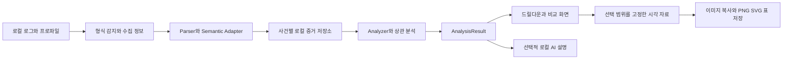
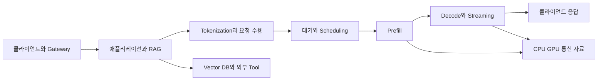

# ArchScope 로컬 장애 및 성능 분석 개선 설계

- 작성일: 2026-11-11
- 상태: 전체 개선 설계 제안, 2026-11-11 리뷰 반영 개정; T-628 공통 기반만 구현
- 대상: Application Architect 중심, TA·DBA 및 AI 서비스 성능 분석 담당자
- 구현 대조 기준: Go/Wails 활성 코드와 작업 트리, 기준 커밋 `bbbe1ae`
- 영문 요약 설계: [Local Diagnostics Evolution Design](../en/LOCAL_DIAGNOSTICS_EVOLUTION_DESIGN.md)

ArchScope의 중심 가치는 **현장에서 확보한 다양한 로그와 프로파일을 로컬에서 분석하고, 장애 원인과 성능 병목의 근거를 좁혀 가며, 보고서에 바로 붙여넣을 시각 자료를 만드는 것**이다. 파일 형식을 많이 여는 것에 더해, 각 자료가 실제로 측정한 대상과 단위를 보존하고 같은 문제를 여러 관점에서 검증할 수 있어야 한다.

이 설계는 py-spy를 비롯한 프로파일 지원 확대, 스택·GC·access 분석의 깊이, GPU·vLLM 등 AI 서비스 자료 해석, 다중 자료 상관 분석, 이미지·도표 제작을 함께 다룬다. **PPT 파일 작성·슬라이드 편집·PPTX exporter 고도화는 개선 범위에 포함하지 않는다.** 사용자는 PNG·SVG·복사한 표를 PowerPoint에 붙여넣어 보고서를 완성한다. 힙덤프 객체 그래프·dominator·retained heap 분석도 구현 대상에서 제외한다.

달력이나 출시 버전을 정하는 로드맵 대신 기능별 설계, 선행 조건, 우선순위, 검증 기준을 제시한다. 아래의 신규 타입·API·저장 형식은 제안이며 현재 지원을 의미하지 않는다. 기존 실행 상태의 기준은 [work_status.md](../../work_status.md)다.

빠른 읽기: [현재 간격](#2-현재-구현과-개선-간격) · [프로파일 확대](#4-프로파일-지원-확대) · [드릴다운](#6-플레임그래프와-드릴다운) · [GPU](#11-gpu-자료-분석) · [vLLM](#12-vllm과-ai-서비스-분석) · [이미지와 도표](#14-보고서에-붙여넣을-이미지와-도표) · [검증](#18-검증과-수용-기준) · [우선순위](#19-우선순위와-선행-관계).

## 1 제품 방향과 범위

### 1.1 사용자가 해결해야 할 질문

| 사용자 | 대표 질문 | 필요한 결과 |
|---|---|---|
| Application Architect | 느린 요청의 시간이 애플리케이션·DB·외부 호출·대기 중 어디에 쓰였는가 | 요청/구간 → 스택 → 호출 관계 → 원본 근거, 개선 전후 비교 |
| TA | CPU가 높은가, 실행을 기다리는가, I/O·컨테이너 제한·GPU 자원이 문제인가 | 프로세스/스레드/호스트별 자원·대기·스케줄링 타임라인 |
| DBA | SQL 실행 자체가 느린가, lock·connection pool·호출 폭증이 문제인가 | SQL fingerprint·실행계획·wait·애플리케이션 호출 연결 |
| AI 서비스 담당 | 첫 토큰이 늦는가, 생성 중 끊기는가, GPU·KV cache·분산 통신이 문제인가 | 요청 단계별 지연, GPU별 상태, Python/CPU/GPU 실행 근거 |
| 보고서 작성자 | 이 결론을 어떤 그림과 표로 설명할 수 있는가 | 재현 가능한 선택 범위와 출처가 붙은 고해상도 이미지·표 |

### 1.2 집중할 영역과 경계

- 분석의 기본 입력은 로컬 파일과 오프라인 증거 묶음이다. Linux 서버에서 수집한 파일을 GPU가 없는 Windows/macOS PC에서 열 수 있어야 한다.
- 프로파일·로그·메트릭·trace를 개별 분석하면서 같은 사건에 연결한다. 데이터가 없는 영역은 필요한 수집 자료를 설명한다.
- 기존 도구의 유지 중단이나 온라인 사용 제약은 수요의 한 원인이다. 특정 제품의 단종 여부를 가정해 호환성을 약속하지 않고, 필요한 파일 형식과 분석 행위를 기준으로 지원한다.
- 이미 좋은 수집기·전문 분석기가 있는 경우 결과를 가져오거나 연결한다. 커널 수집기, GPU 디버거, 힙덤프 엔진을 모두 새로 만들지 않는다.
- 상시 중앙 모니터링, SaaS 업로드, 운영 환경 자동 튜닝, 원격 명령 실행은 이 설계의 중심 범위가 아니다.
- allocation profile, 메모리 사용 시계열, class histogram 텍스트는 분석할 수 있다. 이는 HPROF·core dump 객체 탐색과 별도 기능이다.

### 1.3 성공을 판단할 사용자 흐름

1. 받은 파일을 한 사건에 넣고 형식·수집 시간·측정 단위·누락 정도를 확인한다.
2. 느려진 구간이나 문제가 있는 요청 집단을 선택한다.
3. 스택, GC, DB, 시스템, GPU 자료에서 해당 구간의 근거를 좁힌다.
4. 관측 사실, 원인 후보, 반증 자료, 추가 확인 항목을 정리한다.
5. 선택한 차트와 비교표를 복사해 PowerPoint에 붙여넣는다.
6. 나중에 같은 사건을 열어 동일한 그림과 수치를 재생성한다.

## 2 현재 구현과 개선 간격

현재 상태는 소스와 문서의 정적 대조다. 이 문서를 작성하면서 각 기능의 실제 실행·성능·플랫폼 호환성을 새로 검증한 것은 아니다.

| 영역 | 현재 확인한 기반 | 개선해야 할 간격 |
|---|---|---|
| 실행 구조 | Go 엔진, Wails UI, headless CLI | 새 분석도 같은 구조에 추가하고 별도 서버를 필수화하지 않음 |
| 프로파일 | collapsed/HTML/SVG, pprof, Speedscope, py-spy·rbspy 계열, JFR JSON, V8/Chrome 등 importer와 profiler core | 도구별 실제 출력 검증, 다중 측정값·정밀 단위·시간축·프로세스 경계 통일 |
| 드릴다운 | profiler 드릴다운, 비교, 분류, bounded flame tree | 모든 importer에 동일한 선택·caller/callee·원본 이동·보고서 캡처 의미 적용 |
| perf/eBPF | `perf-collapsed` 경로 | `perf script` 이벤트, 스케줄링, off-CPU, BPF histogram/map의 의미 있는 분석 |
| 스레드 | Java·Go·Python·Node.js·.NET plugin, 멀티 덤프, lock 분석 | 관측 상태와 추론 상태 구분, 프로세스 수명 식별, async task와 OS thread 구분 |
| GC/JFR | JVM 로그, JFR, native memory 분석 | collector/버전별 능력 표시, STW·concurrent 구분, 다른 런타임 GC 자료 확장 |
| access/trace/DB | 다양한 importer, stitching, timeline, service flow | 원본 상세 보존, 비교 집단 통제, 대기와 실행 단계의 분리 |
| 메트릭 | Prometheus/OpenMetrics 텍스트의 `metrics_snapshot` | 시계열·metric type·histogram·counter reset·수집 누락을 보존하는 모델 |
| GPU/vLLM | 일반 log/metrics/profile 기반 재사용 가능 | 전용 semantic adapter, GPU/MIG 식별, 추론 단계·KV cache·GPU 실행 연계 |
| 이미지와 표 | 차트 PNG/SVG export, Evidence Board, Report Pack | 클립보드, 선택 범위 고정, 표 복사, 보고서 스타일과 재생성 경로 일관화 |
| PPTX | 최소 텍스트 exporter 존재 | 신규 개선 대상에서 제외. 이미지·도표 제작으로 요구 충족 |
| AI 보조 | 로컬 Ollama, redaction, evidence reference 검증 | 생소한 자료 설명과 수집 가이드, 계산 근거 검증, 근거 없는 원인 단정 억제 |

근거: [아키텍처](./ARCHITECTURE.md), [Importer 지원표](./IMPORTER_SUPPORT_MATRIX.md), [멀티 언어 스레드](./MULTI_LANGUAGE_THREADS.md), [보고서 export](./REPORT_EXPORT_DESIGN.md), [프로파일 파서](../../apps/engine-native/internal/parsers/profile/parser.go), [메트릭 파서](../../apps/engine-native/internal/parsers/metrics/parser.go), [메트릭 분석기](../../apps/engine-native/internal/analyzers/metrics/analyzer.go), [PPTX 구현](../../apps/engine-native/internal/exporters/pptx/exporter.go).

### 2.1 확장 전에 확인할 구체적인 정확성 문제

| 코드에서 확인한 동작 | 설계상 위험 | 먼저 확보할 회귀 기준 |
|---|---|---|
| `parseSpeedscope`가 weight를 정수화하고 최소 1로 처리 | 소수 시간·0 weight의 의미가 바뀔 수 있음 | 0, 소수, 매우 큰 weight를 가진 원본과 합계·단위 일치 |
| Speedscope evented 경로가 close event마다 `Value: 1` 생성 | 구간 길이가 호출/샘플 횟수처럼 취급될 수 있음 | open/close 시각으로 산출한 self/inclusive duration 검증 |
| evented 처리가 전체 `samples` 길이를 조건으로 사용 | 여러 profile을 가진 파일에서 후속 evented profile이 빠질 가능성 | sampled/evented 혼합 파일의 모든 profile 보존 |
| pprof importer가 선택된 value 하나와 sample type 이름을 중심으로 투영 | bytes·nanoseconds·count 및 다른 sample type이 충분히 드러나지 않을 수 있음 | 다중 sample type 선택과 unit·period·0 값 보존 |
| metrics parser가 `#` 라인을 건너뛰고 analyzer는 제한된 samples를 표시 | metric type·histogram 의미와 전체 시계열을 재구성하기 어려움 | TYPE/HELP/UNIT 보존, 전체 입력 집계와 화면 top-N 분리 |
| 멀티 스레드 문서 일부는 언어 자유 조합으로 표현하지만 registry는 mixed format 거부 | 사용자에게 실제 지원보다 넓은 동작을 약속 | 동일 프로세스 덤프 비교와 다중 런타임 사건 분석을 구분해 문서 정합화 |

위 항목은 수정 완료 보고가 아니다. 각 구현 작업에서 최소 재현 fixture와 기대값을 먼저 확정한다. 기존에 보완한 단위 처리·대용량 제한을 없애지 않고, importer와 profiler core 사이의 일관성을 검증한다.

## 3 공통 분석 구조



### 3.1 책임 분리

| 계층 | 책임 | 다른 계층으로 넘길 일 |
|---|---|---|
| 수집 안내 | 필요한 자료·권한·오버헤드·수집 설정 설명 | 자동 attach·운영 환경 변경 |
| Parser | 파일 구문, 원본 필드, 위치, 오류·누락 식별 | 장애 판정·시각화 |
| Semantic adapter | 도구/버전별 단위, 측정 대상, clock·entity 정규화 | 업무 임계값 기반 판정 |
| Analyzer | 집계, 비교, 구간 분석, 근거가 있는 finding | UI 필터 상태·파일 export |
| 상관 분석기 | 식별자와 시간 근거로 관계 생성 | 시간상 동시 발생을 인과관계로 확정 |
| UI | 탐색, 필터, 설명, 선택·주석 | 별도의 비공개 수식으로 수치 재계산 |
| Exporter | 고정된 분석 뷰를 이미지·표로 렌더링 | 원본 로그 재파싱·새로운 원인 추론 |

### 3.2 사건 단위 작업 공간

기존 Analysis Workspace를 사건 단위로 강화한다. 사건에는 증상, 영향 시간대, 서비스·프로세스 목록, 자료 manifest, 분석 결과, 선택 범위, 비교 기준, 주석, 내보낸 시각 자료의 생성 조건을 저장한다.

- 파일 교체·추가·삭제 시 해당 결과와 파생 그림을 `stale`로 표시한다. 저장된 과거 그림과 최신 결과를 조용히 섞지 않는다.
- source hash, parser/adapter/rule 버전, 분석 옵션으로 재계산 필요성을 판단한다.
- 원본은 읽기 전용 참조가 기본이다. 휴대용 사건 묶음에는 사용자가 선택한 비식별 자료만 포함한다.
- 원본 없는 공유 묶음은 집계·그림을 열 수 있지만, 상세 드릴다운 가능 범위를 명시한다.
- CPU·GPU가 없는 PC에서도 파일 분석은 가능해야 한다. 데이터 수집 환경과 분석 PC의 기능을 구분한다.

### 3.3 수집 묶음과 사건 수명주기

수집자와 분석자가 달라도 조건을 재구성할 수 있도록 `capture-manifest.json` sidecar를 반입한다. ArchScope가 요구하는 계약은 다음과 같고, 실제 범용 수집 recipe/JSON Schema는 공유 자산으로 관리한다.

| 필드 묶음 | 보존할 정보 |
|---|---|
| 버전·범위 | capture schema, bundle ID, producer/version, 파일별 format hint·hash·size |
| 실행 주체 | 비식별 host/boot/process-start, PID/TID namespace, container/pod, vendor-specific device mapping |
| 시간 | 시작/종료, timezone, clock domain, anchor/uncertainty와 근거 |
| 수집 조건 | allow-list로 정제한 옵션, sample interval, 포함/제외 필터, workload·warmup 구간 |
| 품질·변환 | lost/partial, converter/version/location, 원본/변환 hash와 소실한 capability |
| 개인정보 | 적용한 redaction profile/version, 원본 포함 여부, 수집자 설명 |

manifest 값은 수집 도구 관측·사용자 입력·추정의 출처를 구분한다. 파일 안의 실제 header와 충돌하면 경고하고 자동 덮어쓰지 않는다. 전체 shell command·환경 변수·credential을 저장하지 않는다. bare log 반입도 가능하지만 미확인 clock/entity는 그대로 미확인 상태다.

일괄 ZIP/TAR 반입은 항목 목록과 압축 해제 예상 크기를 먼저 보여 준다. 경로 탈출·symlink/hardlink·중복 경로·중첩 압축·해제 크기/파일 수 예산을 검증하고 staging 공간에 해제한다. manifest와 파일 hash를 대조해 host/process/time으로 그룹화하며, 같은 basename만으로 파일을 합치지 않는다. 중복 bytes는 공유할 수 있어도 서로 다른 수집 사건의 provenance는 유지한다. 부분 실패한 파일과 성공한 파일을 각각 확정한다.

encoding은 명시 옵션 → BOM → 허용된 sniff 순으로 결정한다. UTF-8·UTF-16LE/BE·CP949·EUC-KR fixture를 사용하고 replacement 문자 수·선택 근거·사용자 override를 기록한다. 디코딩 후 줄 번호와 원본 byte 범위를 연결하고, encoding 변경 시 index를 다시 만든다. CP949와 EUC-KR을 같은 label로 처리하지 않는다.

사건 상태는 `active → archived → restored`, 삭제는 별도 `deleted`로 둔다. 저장 위치는 OS별 앱 데이터 하위의 사건 ID 디렉터리이고, 원본 외부 파일 참조는 별도 관리한다. 보존 기간은 사용자가 설정하며 기본적으로 사건을 자동 삭제하지 않는다. cache 정리는 재생성 가능한 index/temp만 제거한다. archive는 선택한 비식별 자료·snapshot·visual spec과 결과를 묶으며 복원 시 버전·hash를 확인한다.

삭제 전에 원본 외부 파일, 앱 소유 복사본, cache, AI 임시 자료, export, OS clipboard의 파기 범위를 표시한다. 외부 원본·사용자가 따로 저장한 export·OS backup을 앱 소유 cache와 함께 삭제하지 않는다. SSD와 백업의 물리적 완전 삭제를 보증하지 않는다. 암호화된 OS 저장소 사용과 작업 후 clipboard 정리도 안내한다.

baseline은 immutable result revision과 workload/capture 조건의 참조로 등록한다. 다른 사건에서 사용할 때 민감정보·자료 가용성을 확인하고 같은 metric/모집단 조건이 맞는지 다시 검사한다. baseline 원본을 삭제한 뒤에도 snapshot이 남았다는 사실과 재계산 불가를 표시한다.

### 3.4 모든 수치에 필요한 의미

측정값은 최소한 value와 `unit`, `measurement_kind`, `scope`, `aggregation`, `availability`, `evidence_ref`의 의미를 갖는다. 직렬화는 §16.8처럼 scalar와 별도 descriptor를 사용하며 기존 scalar를 객체로 일괄 교체하지 않는다. UI에는 사람이 이해할 수 있는 이름으로 표시한다.

| 구분 | 예 | 혼합하면 안 되는 값 |
|---|---|---|
| 샘플 수 | 특정 stack이 관측된 횟수 | 실제 함수 호출 횟수 |
| CPU 시간 | 여러 thread가 사용한 CPU 시간 합계 | 요청 응답시간 |
| 경과 시간 | 한 요청의 시작부터 종료까지 | 병렬 자식 span duration 합계 |
| 대기 시간 | scheduler·lock·I/O wait | CPU 실행 시간 |
| 메모리 | allocation bytes, 현재 사용 bytes | 객체 그래프의 retained heap |
| GPU 시간 | kernel duration 합계, 구간 합집합 | CPU launch 시간, 전체 장치 사용률 |
| 요청/토큰 | 처리 완료 요청, prompt/output token | 네트워크 chunk, 재시도 attempt |

미수집은 `null`과 이유로 표현한다. 0, 수집 불가, 형식 미지원, 잘림, 추정값을 구분한다. 합계는 전체 유효 입력을 기준으로 계산하고, 화면 downsampling·top-N은 별도 변환으로 남긴다.

## 4 프로파일 지원 확대

### 4.1 도구 이름보다 파일 형식과 분석 능력을 관리

하나의 profiler가 여러 형식으로 출력하고, 같은 형식을 여러 도구가 사용한다. 지원 단위는 `producer + producer_version + format + measurement_kind + capabilities` 조합으로 한다. 공통 importer를 재사용하되, 실제 producer의 파일로 호환성을 확인한다.

각 항목은 `지원`, `제한 지원`, `외부 변환 필요`, `미지원`으로 표시한다. 지원 능력에는 stack, self/inclusive weight, 시간 선택, process/thread 분리, 원본 위치, 비교가 포함된다. 파일을 파싱했다는 이유만으로 모든 능력을 활성화하지 않는다.

| 계열 | 우선 입력 및 확장 후보 | 강화할 분석 | 위치 |
|---|---|---|---|
| Python py-spy | raw/folded, Speedscope, 기존 SVG에서 복원 가능한 데이터, dump 텍스트 | worker/thread별 hotspot, Python/native 경계, 선택 구간, 비교 | 최우선 |
| Python 기타 | Pyinstrument JSON, Austin 출력, Scalene JSON, cProfile/pstats의 안전한 구조화 export | wall/CPU·line·호출 통계 차이 보존 | 후속 adapter |
| JVM async-profiler | collapsed, HTML, JFR 및 event JSON | CPU/wall/alloc/lock별 분리, Java/native/kernel, JFR 연계 | 최우선 |
| Go·공통 pprof | gzip protobuf, 다중 sample type | CPU, alloc/inuse bytes/objects, block/mutex 등 원본 측정값별 뷰 | 최우선 |
| Linux perf | collapsed에서 `perf script`로 확대, 필요 시 외부 변환한 `perf.data` | event/period, process/thread/CPU, native/kernel stack | 우선 확장 |
| eBPF/BCC/bpftrace | 정의된 JSONL·folded·histogram export | on/off-CPU, run queue, block I/O, network·syscall 대기 | 우선 확장 |
| Node.js·브라우저 | V8 `.cpuprofile`, Chrome trace, 진단 report | main/worker 구분, CPU와 event-loop 관측 연결 | 기존 경로 고도화 |
| .NET | Speedscope export, EventPipe/ETW의 승인된 변환 결과 | managed/native, thread pool, GC, contention·async 연계 | 변환 경로 우선 |
| Ruby | rbspy 지원 출력, StackProf JSON export | mode·thread·frame·가중치 보존 | 기존 경로 고도화 |
| PHP | Xdebug Cachegrind, Excimer/Tideways 구조화 export | call count·self/inclusive cost·파일/함수별 비교 | 기존 경로 고도화 |
| Native C/C++/Rust | perf/pprof/Callgrind, Instruments export 후보 | symbol/build ID, inline frame, 비용 종류별 call graph | 공통 형식 우선 |
| AI 연산 | PyTorch trace, Nsight Systems SQLite/CSV export | CPU operator → CUDA → kernel/memcpy/통신 | GPU 설계와 연결 |
| 지속 프로파일링 | Pyroscope/Parca의 다운로드 파일, 향후 OTLP Profiles | 선택 기간·서비스·label·sample type 보존 | 기존 결정 노트 준수 |

이 표의 확장 후보는 모두 현재 지원을 뜻하지 않는다. 특히 원본 `.nettrace`, ETL, Instruments `.trace`, 임의의 Python/Ruby 직렬화 파일을 JSON처럼 읽는다고 표시하지 않는다. native binary 직접 지원은 안정된 decoder·배포 비용·버전 fixture가 준비된 뒤 판단한다. [OTLP Profiles 결정](./OTLP_PROFILES_DECISION.md)은 별도 선행 기준으로 유지한다.

### 4.2 py-spy를 기준으로 완성할 사용자 경험

py-spy는 `record`와 `dump`의 목적이 다르며, record는 SVG 외에 Speedscope와 raw 출력을 제공한다. native frame, GIL 관련 필터, subprocess 등의 수집 옵션도 결과 해석에 영향을 준다. [py-spy 공식 설명](https://github.com/benfred/py-spy#usage).

ArchScope에는 다음 동작을 제안한다.

1. **입력 분리**: `record --format raw`의 folded stack은 해당 문법으로, `dump`의 thread snapshot은 스레드 파이프라인으로 보낸다. 기존 `pyspy-raw` 별칭의 존재만으로 실제 raw record 호환성을 판정하지 않는다.
2. **수집 조건 확인**: producer/버전, Python 버전, sample rate, duration, native·idle·GIL·subprocess 옵션을 manifest에 남긴다. 파일에 없으면 사용자가 보완하고 `사용자 입력`으로 표시한다.
3. **프로세스와 스레드 선택**: worker별 비중·함수 hotspot·미해석 frame 비율을 나란히 표시한다. 합계만 보여 worker 편중을 숨기지 않는다.
4. **두 종류의 보기**: raw/folded는 집계 flamegraph, 순서와 시간 단위가 보존된 Speedscope는 시간 구간 선택을 제공한다. 집계 파일에 시간축을 만들어 내지 않는다.
5. **원인 탐색**: tokenizer, serialization, application code, native extension 등의 후보를 스택 근거와 연결한다. Python 샘플만으로 CUDA kernel 병목이나 GIL 경합을 확정하지 않는다.
6. **조건이 같은 비교**: 동일 workload·수집 옵션·단위의 두 프로파일을 비교하고, 조건 차이를 결과 상단에 표시한다.
7. **보고서 캡처**: 선택한 worker·함수 경로·분모·수집 조건을 포함한 flamegraph와 Top N 표를 한 번에 복사한다.

Python free-threaded 실행 여부 등 런타임 차이도 manifest에 보존한다. GIL 관련 정보가 없는 profile에서는 GIL 보유율·경합률을 계산하지 않는다. `--locals`처럼 민감한 값을 포함할 수 있는 자료는 기본 시각 자료에 노출하지 않는다.

### 4.3 공통 프로파일 내부 모델

외부 `AnalysisResult`를 대체하지 않고, 분석 엔진 내부에 다음 구조를 둔다.

| 구조 | 필수 의미 |
|---|---|
| ProfileSet | producer/version, format, capture options, profile 목록, 원본 hash |
| Profile | profile ID, process/thread/worker, measurement kind, unit, 시간 성격 |
| Frame | 원본 symbol, 표시 이름, module/build ID, file/line, inline/native/kernel 구분 |
| Sample | stack ID, 원본 weight, metric ID, 선택적 timestamp/interval, labels |
| EventSpan | 시작·종료, track, parent/flow 관계, 상태, 원본 event reference |
| Quality | lost/unknown/truncated 수, symbol 해석 비율, clock 신뢰도, 변환 손실 |

weight를 무조건 정수 샘플 수로 바꾸지 않는다. 시간은 정밀도를 보존하는 정수 tick과 scale 또는 검증된 소수 표현을 사용하고, JS 정수 안전 범위를 넘는 값은 문자열로 전달한다. 계산용 단위와 표시용 ms·MiB 등을 분리한다. 여러 sample type을 가진 파일은 사용자가 측정값을 선택하게 한다.

pprof에는 sample type별 단위, 여러 value, period와 수집 기간이 포함될 수 있다. importer는 이 의미를 보존하고 기본 선택만 projection으로 만든다. [pprof 원본 스키마](https://github.com/google/pprof/blob/main/proto/profile.proto).

### 4.4 Speedscope와 시간 기반 프로파일

Speedscope는 sampled/evented profile과 단위·시작/종료 값·weights를 구분한다. 이 구분을 내부 모델에도 유지한다. [Speedscope 형식 정의](https://github.com/jlfwong/speedscope/blob/main/src/lib/file-format-spec.ts).

- sampled: 각 stack의 weight를 보존한다. 시간 단위이며 producer의 순서 의미가 확인된 경우에만 상대 시간 탐색을 제공한다.
- evented: open/close의 순서·frame 대응·범위를 검증하고, 인접 이벤트 사이의 활성 stack 구간을 계산한다. close 횟수로 duration을 대체하지 않는다.
- 여러 profile은 독립 track으로 보존한다. 서로 다른 process의 상대 시간 0을 같은 절대 시각으로 간주하지 않는다.
- self/inclusive 값과 flamegraph 폭은 동일한 측정값을 사용한다. duration 없는 자료는 duration 열을 비활성화한다.
- 호출 수는 instrumentation이 기록한 경우에만 표시한다. sampling 횟수는 함수 실행 횟수가 아니다.

### 4.5 프로파일 비교와 심볼

비교는 원시 weight 변화와 정규화된 비중 변화를 함께 제공한다. baseline이 0이면 변화율 대신 신규 발생으로 표시한다. 서로 다른 단위, CPU와 wall, allocation과 in-use는 직접 뺄 수 없다.

signed diff의 음수는 감소량으로 보존하되 음수 폭의 flame node로 만들지 않는다. 일반 profile의 음수·비유한 weight는 포맷 정의에 따라 거부하거나 명시적 오류로 남긴다. 0이나 작은 소수를 최소 1로 보정하는 방식은 사용하지 않는다.

정규화 기준은 관측 시간당·요청당·토큰당 등 사용자가 선택하고, 분모가 같은 관측 집단에 속하는지 확인한다. 프로파일에 요청 연결이 없으면 요청당 값은 사건 전체의 비율 추정으로 표시한다. 표본 수가 적을 때 자동으로 통계적 유의성을 주장하지 않는다.

함수 비교 키는 표시 문자열만 쓰지 않고 module·build ID·원본 symbol·inline 경로를 고려한다. 버전 간 경로·line 이동은 사용자가 확인 가능한 alias로 연결한다. symbol이 없으면 주소를 유지하고, 수동으로 등록한 로컬 symbol 경로만 사용한다. 외부 symbol server 접속을 기본 동작으로 두지 않는다.

### 4.6 외부 변환의 제품 계약

기존 도구로 변환해야 하는 포맷은 `외부 변환 필요`로 안내한다. 변환 도구 버전, 원본/결과 hash, 실행 옵션, 없어지는 정보, stderr 요약을 manifest에 남긴다. 변환 프로그램의 경로·인자는 검증된 목록으로 구성하고 로그 속 명령을 실행하지 않는다.

Python pickle/marshal, Ruby Marshal 등 실행 환경 의존 직렬화는 메인 앱에서 직접 복원하지 않는다. 신뢰할 수 있는 현지 도구가 안전한 JSON/CSV/표준 profile로 내보내도록 한다. 변환으로 시간·label이 사라졌으면 해당 기능을 제한한다. async-profiler 역시 event와 interval 의미가 모드마다 다르므로 확장자만으로 CPU 시간으로 해석하지 않는다. [async-profiler 옵션](https://github.com/async-profiler/async-profiler/blob/master/docs/ProfilerOptions.md).

## 5 perf와 eBPF 분석

T-637 구현과 검증 범위는 [시스템 근거](SYSTEM_EVIDENCE.md)를 참고한다.

### 5.1 입력을 세 종류로 구분

| 입력 | ArchScope의 처리 | 복원할 수 없는 정보 |
|---|---|---|
| folded stack | 기존 profiler 경로로 집계, weight 단위와 수집 조건 추가 | 소실된 이벤트 순서·요청별 시간 |
| `perf script`·정의된 JSONL event | timestamp, event kind, CPU, PID/TID, period, stack 보존 | 수집하지 않은 scheduler·I/O 이벤트 |
| BPF map·histogram 집계 | key 차원, bucket 경계, interval·reset 의미 유지 | 개별 이벤트·개별 요청의 정확한 latency |

`perf script`는 출력 field와 event type별 구성 차이가 있으므로 producer 설정을 입력 계약으로 받는다. `perf.data`는 우선 현지 perf 도구가 text/구조화 자료로 변환하는 경로를 사용한다. [Linux perf 문서](https://github.com/torvalds/linux/blob/master/tools/perf/Documentation/perf-script.txt).

bpftrace는 JSON Lines 형태의 출력 경로가 있지만 script가 만든 내용의 의미까지 통일해 주지는 않는다. `tool_version`, `script_hash`, event schema, 단위, 집계 구간을 별도로 확인한다. [bpftrace 출력 형식](https://bpftrace.org/docs/0.22).

### 5.2 먼저 제공할 분석 뷰

- **CPU 실행**: user/kernel, process/thread, event별 hotspot과 sample/period 기준 비중.
- **off-CPU**: thread가 실행되지 않은 시간의 stack 분포. runnable 대기와 잠든 대기를 구분할 증거가 없으면 미분류로 둔다.
- **스케줄링**: wakeup → sched-in, sched-out → sched-in 구간을 각각 run-queue 지연과 off-CPU 구간으로 표시한다. 시작/끝 짝이 없는 이벤트는 불완전 구간으로 남긴다.
- **block I/O**: 장치·operation별 지연 분포와 bytes, queue/service 단계가 실제 기록되었는지 표시한다.
- **network/syscall**: 연결·재전송·syscall duration을 원본 의미대로 분리하고, syscall 대기를 바로 원격 서비스의 처리시간으로 부르지 않는다.
- **컨테이너 제한**: cgroup throttling, CPU quota, PSI, host CPU·I/O 자료가 있다면 같은 시간대에 배치한다. 평균 CPU 사용률만으로 여유를 판단하지 않는다.

PMU의 cycles·instructions·cache misses는 서로 다른 event다. sampling period를 시간으로 간주하지 않고, `time_enabled/time_running` 같은 근거가 있는 counter multiplex 보정만 허용한다. thread별 비용 합계는 병렬 실행 때문에 wall time보다 클 수 있다.

### 5.3 손실과 수집 영향

buffer overflow, lost event, stack unwind 실패, kernel symbol 미해석, clock 정보 누락을 품질 패널에 표시한다. 손실된 이벤트를 임의로 보간해 정상 데이터처럼 만들지 않는다. bpftrace의 비동기 출력은 이벤트 손실·지연의 영향을 받을 수 있으므로 집계와 출력 이벤트를 같은 완전성으로 취급하지 않는다. [bpftrace 비동기 동작](https://bpftrace.org/docs/release_027/stdlib).

수집 도우미는 대상 OS·kernel·권한과 오버헤드를 설명하는 안내부터 제공한다. ArchScope를 열었다는 이유로 BPF program을 attach하거나 권한 설정을 바꾸지 않는다.

## 6 플레임그래프와 드릴다운

### 6.1 모든 프로파일에 공통인 탐색

```text
사건 → 프로파일/측정값 → process/worker/thread → 시간 범위
     → stack 또는 함수 → caller/callee → 원본 근거 → 시각 자료로 저장
```

필터는 숨겨진 상태가 되지 않도록 breadcrumb와 선택 조건으로 표시한다. 뒤로 가기·전체 복원·현재 선택 링크·선택 저장을 제공한다. focus와 exclude는 수치의 분모를 어떻게 바꾸는지 명시한다.

| 보기 | 답하는 질문 | 필수 표시 |
|---|---|---|
| Flamegraph | 누적 비용이 어느 stack에 집중되는가 | 폭의 단위, 전체/선택 분모, self/inclusive |
| Flamechart | 어느 시점에 어떤 stack이 관측·실행되었는가 | 시간축의 출처, gap, sampled 또는 traced 구분 |
| Bottom-up | 호출 위치와 무관하게 비싼 함수는 무엇인가 | 함수별 self, 전체 기여, 호출 경로 |
| Caller/Callee | 이 함수의 비용이 어디서 왔고 어디로 갔는가 | 선택 경로와 전체 함수 집계의 차이 |
| Diff flamegraph | 같은 조건에서 비용 분포가 어떻게 바뀌었는가 | 기준/비교 값, 절대 변화, 비중 변화, 비교 조건 |
| 원본 패널 | 이 그림이 어느 자료에서 나왔는가 | 파일 식별자, line/event/sample 범위, 변환 이력 |

집계 flamegraph의 가로 배치는 시간 순서가 아니다. 기존 category 기반 breakdown도 실제 타임라인과 분리한다. 시간 정보 없는 입력에는 시간 구간 선택을 표시하지 않는다.

### 6.2 상세 데이터와 표시 예산

화면에 보이는 top-N만 다시 분석하면 깊게 들어갈수록 원본 비용이 사라진다. 선택 쿼리는 정규화한 전체 자료 또는 재현 가능한 원본 인덱스에 실행하고, 렌더링 결과만 제한한다.

- `기타` 노드는 숨겨진 weight를 보존한다. 표시 가지를 줄여도 전체와 선택의 합계는 변하지 않는다.
- 아직 인덱스가 없는 입력은 명시적 재파싱으로 드릴다운하거나 제한 이유를 표시한다.
- 검색어 일치, recursive frame, 동일 이름의 다른 module, inline frame을 구별한다.
- UI에서 숨긴 framework frame은 원본에서 삭제하지 않는다. 표시용 folding은 원복 가능하게 한다.
- 요청·thread·GPU stream처럼 관계가 다른 축을 하나의 가짜 호출 트리로 합치지 않는다.
- 표·flamegraph·설명문·내보낸 그림은 같은 선택 revision을 사용한다.

### 6.3 드릴다운 완료 기준

전체 → 함수 A → 하위 B로 이동한 뒤 뒤로 돌아오면 같은 합계가 재현되어야 한다. 입력 순서 변경·동일 이름 frame·deep recursion·시간 없는 파일·pruned tree에서도 분모와 단위가 맞아야 한다. 부모 inclusive 값과 자식·self의 관계는 동일한 집계 정의 안에서 검증하고, async/중첩 interval은 단순 트리 합산 규칙을 강제하지 않는다.

## 7 스레드와 언어별 스택 분석

### 7.1 런타임별로 추가할 깊이

| 런타임 | 현재 기반 위의 개선 | 필요한 추가 자료 | 피해야 할 해석 |
|---|---|---|---|
| JVM | virtual/platform thread 구분, carrier·pinning 근거 연결, lock owner/waiter, 여러 dump 변화 | jstack/jcmd, JFR, process CPU, runtime version | RUNNABLE을 CPU 사용으로 확정, 단순 parking을 lock 경합으로 확정 |
| Python | py-spy dump와 record 연결, native frame, thread/async task 구분 | dump, profile, event-loop/async instrumentation | 스택 한 장으로 GIL 경합 시간·모든 coroutine 상태 추정 |
| Go | goroutine 집단과 생성 stack, block/mutex profile 연결 | goroutine dump, pprof, 필요 시 runtime trace export | goroutine과 OS thread의 1:1 대응 |
| Node.js | main/worker, event-loop 지연, libuv handle·pool과 CPU profile 연결 | diagnostic report, V8 profile, event-loop metric | 열린 socket handle이 현재 요청 지연의 원인이라고 단정 |
| .NET | managed/native stack, ThreadPool 대기, async continuation, GC event 연계 | clrstack, EventPipe/ETW 변환 결과 | `MoveNext` 이름만으로 동일 async 작업 연결 |
| Native | symbolized stack, thread state, scheduler·mutex 관측 연계 | stack text, perf/BPF/플랫폼 trace | 임의 core dump의 모든 객체·stack 복원 |

### 7.2 멀티 덤프의 식별과 시간

동일 thread 판정은 이름만으로 하지 않는다. process identity, process start/boot ID, runtime thread ID, dump 시간과 형식 범위를 함께 사용한다. PID/TID 재사용, 재시작, 같은 이름의 worker는 별도로 취급한다.

여러 덤프에 같은 stack이 남아 있는 것은 관측 시점 사이의 지속 정체 후보다. 덤프 사이 전체 시간을 계속 실행·대기했다고 확정하지 않는다. 상태 전이와 관측 간격을 함께 표시한다.

서로 다른 런타임 자료는 사건의 공통 시간축에 올릴 수 있다. 그러나 한 언어의 thread ID를 다른 언어의 thread ID와 연결하지 않는다. 현행 mixed-format 제한은 유지하면서, 상위 사건 계층이 runtime별 분석 결과를 묶도록 확장한다.

### 7.3 상태 추론을 설명 가능하게 만들기

`observed_state`, `inferred_category`, `rule_reference`, `confidence_reason`을 구분한다. 실제 owner/waiter 관계가 있는 lock과 함수 이름 기반 대기 추정을 다른 기호로 보여 준다. deadlock은 확인된 관계의 cycle과 단순한 stack 유사도를 분리한다.

표준 결과는 thread 상태 분포, 반복 stack 집단, 변화 heatmap, lock graph, 느린 구간과 연결된 stack 카드다. thread가 많을 때 이름 목록보다 집단별 수·영향·대표/예외 stack을 먼저 제시하고 원본으로 내려갈 수 있게 한다.

### 7.4 Python·Node·Rust와 CPU 관측 연결

Python의 asyncio task export, ASGI/WSGI 및 작업 큐 worker 로그를 별도 입력으로 받는다. task ID·worker/process identity·관측 시간이 있을 때만 py-spy와 연결한다. CPU sampling만으로 모든 coroutine의 대기 시간이나 GIL 보유 시간을 복원하지 않는다. memray와 tracemalloc은 실제 export 형식·버전별 allocation 통계와 stack 집계부터 지원하며 객체 참조 그래프 분석은 제외한다. Node/TypeScript는 V8 profile, diagnostic report, event-loop/worker 지표를 우선 연결하고 source map은 사용자가 제공한 로컬 파일만 사용한다.

Rust는 원본 symbol과 demangled display name을 함께 저장한다. `::` 포함 여부만으로 런타임을 확정하는 현행 추론을 보완하고, producer·binary·명시적 언어 정보와 함께 confidence를 남긴다. hash 문자열을 무조건 제거해 서로 다른 frame을 합치지 않는다. panic/backtrace text는 오류 위치 근거로, perf/pprof는 비용 근거로 사용한다. async task의 poll/wake/대기는 수집된 task event가 있을 때만 표현한다. 심볼 규칙은 [rustc 공식 문서](https://doc.rust-lang.org/rustc/symbol-mangling/index.html)를 기준으로 resolver별 fixture를 고정한다.

`top -H`/`ps -L`의 CPU 값은 producer별 측정 window와 누적·구간 의미를 보존한다. JVM `nid`의 16진수와 OS TID의 10진수 변환만으로 연결을 확정하지 않는다. 같은 host, PID namespace, process 시작·수집 window를 확인하고 PID/TID 재사용·container 매핑 누락이면 후보로 남긴다. dump는 순간 stack이고 CPU는 다른 구간의 관측일 수 있으므로 연결 오차를 표시한다.

## 8 GC와 메모리 압력 분석

### 8.1 collector와 런타임별 지원 능력

JVM의 legacy/unified/G1 입력 기반을 유지하되, `JDK 버전 × collector × 로그 옵션`별 지원표를 만든다. 공통 문법 일부가 파싱된다고 ZGC·Shenandoah·OpenJ9의 전체 이벤트 의미가 지원된다고 표시하지 않는다. 추가 collector는 개별 fixture로 pause·concurrent·cycle 의미를 검증한다.

| 확장 대상 | 분석 결과 | 입력 경계 |
|---|---|---|
| JVM GC와 safepoint | STW 분포, concurrent 구간, allocation/reclamation 추세, safepoint 대기 | 로그 옵션에 실제 있는 정보만 사용 |
| JVM native memory | heap·metaspace·direct/native·process RSS 비교 | NMT/OS 관측 시각과 범위를 표시 |
| .NET GC | generation, pause, allocation 및 thread pool과의 동시 변화 | EventPipe/ETW 구조화 export부터 |
| Go GC | gctrace/runtime metric의 cycle·pause·heap 변화 | 버전별 형식과 단위를 별도 adapter로 처리 |
| Node/V8 GC | trace-gc 또는 trace event의 pause·heap 변화 | V8 버전·수집 옵션 보존 |
| Python GC | 수집된 callback/metric의 collection 관측 | JVM과 같은 세대·STW 의미를 강제하지 않음 |

### 8.2 공통 개선 사항

- GC pause 비율의 분모는 유효 관측 시간이다. 첫/마지막 event 사이만 가진 경우 그 범위를 표시한다.
- STW 구간의 합집합과 concurrent cycle duration 합계를 분리한다. concurrent duration 전체를 애플리케이션 정지 시간으로 계산하지 않는다.
- allocation rate는 제공된 counter/이벤트와 시간 차로 계산한다. before/after heap 차이는 중간 allocation과 collection을 모두 설명하지 못할 수 있다.
- 반복되는 old generation 증가·OOM·promotion 관련 증거를 원인 후보로 제시하되, 로그만으로 memory leak의 객체 경로를 확정하지 않는다.
- Java heap OOM, direct/native 부족, 컨테이너 OOMKill, GPU OOM을 다른 현상으로 분류한다.
- restart·rotation·중복 파일·uptime reset을 구간 경계로 인식하고 GC ID를 프로세스 수명 안에서만 사용한다.
- access latency, CPU throttling, thread 상태와 시간축을 맞춰 GC의 동시 발생·선후관계를 검토한다.

화면에는 pause timeline, 분포/긴 꼬리, heap 변화, GC 전후 점유, collector별 phase, 사건 구간 비교를 제공한다. 원본에는 없는 세대별 값이나 phase별 시간을 빈칸 대신 0으로 채우지 않는다.

### 8.3 힙덤프와의 경계

HPROF·객체 참조 그래프·dominator tree·retained size 엔진은 만들지 않는다. 분석 결과에서 사용자가 등록한 전문 도구와 수동 진단 절차로 연결할 수 있다. pprof allocation/in-use 통계와 텍스트 class histogram은 비용·추세 자료로 유지하되 객체 참조 분석으로 설명하지 않는다.

## 9 Access와 데이터베이스 및 시스템 자료

### 9.1 Access 분석의 개선

기존 다중 web/edge format을 바탕으로 사용자가 필드 매핑을 미리 검증할 수 있게 한다. 입력 라인 → 추출 필드 → 단위·시간대 → 집계 결과를 한 화면에서 확인하고, 매핑 preset은 버전 관리한다.

- endpoint template, method, status, service, upstream, request size, retry 여부별로 지연 집단을 나눈다.
- 평균 외에 histogram/heatmap, p50/p95/p99, 오류와 timeout·취소 분포를 제공한다. latency 없는 요청은 요청 수에 포함하고 latency 분모에서는 제외한다.
- gateway total, upstream connect/header/response 등 관측 지점을 구분한다. 서로 포함된 duration을 더하지 않는다.
- retry attempt와 논리 요청을 분리한다. HTTP 2xx여도 중간 stream 실패나 응답 내부 오류가 확인되면 별도 관측으로 남긴다.
- 로그 sampling·종료 요청만 기록하는 방식·수집 누락 때문에 실제 수요나 대기 요청을 과소평가할 수 있음을 coverage에 반영한다.
- 비교 시 트래픽 양·endpoint 구성·payload·시간대·warmup이 달라졌는지 보여 준다. 전체 평균 변화가 집단 구성 변화 때문인지 구분한다.

파일 회전·gzip·인코딩·혼합 timezone·부분 라인·멀티라인 오류를 ingestion 공통 계층에서 다룬다. 이미 보완한 미측정 latency의 `null` 의미를 모든 차트·표·비교에서 유지한다.

### 9.2 DBA에게 필요한 연결

slow query, SQL fingerprint, EXPLAIN 자료를 별도로 분석하면서 애플리케이션 요청과 연결한다. query 실행 시간, connection pool 획득 대기, lock wait, 네트워크·결과 전송, client fetch를 각각 관측된 범위로 표시한다.

실행계획 비교는 node 종류·추정/실제 row·loop·시간 등 실제 export 필드의 지원표부터 만든다. 일반 EXPLAIN만 있으면 실제 실행시간을 생성하지 않는다. SQL text의 literal·bind·고객 데이터를 마스킹한 뒤 fingerprint와 구조만 보고서에 남긴다.

PostgreSQL/MySQL 등 기존 입력의 분석 깊이를 먼저 높인다. Oracle AWR/ASH·상용 DB 자료는 사용자 수요와 파일 제공 조건을 확인한 뒤 별도 adapter로 검토하며, 해당 기능의 수집·사용 권한을 일괄 가정하지 않는다. DB에 접속해 EXPLAIN ANALYZE를 자동 실행하지 않는다.

### 9.3 TA 자료의 보강

`sar`, `pidstat`, `iostat`, `vmstat`, PSI/cgroup, kernel/journal, Kubernetes event와 pod resource 자료의 text/JSON export를 확장 후보로 둔다. 버전·locale·interval을 보존하고 CPU·메모리·disk·network·재시작을 사건 시간축에 올린다. 분당 평균과 millisecond stack event를 같은 해상도로 보간하지 않는다.

### 9.4 비교 조건과 장애 자료

JMeter JTL, nGrinder, k6, Gatling, GenAI-Perf·llmperf의 결과는 도구별 fixture가 확보된 형식부터 workload 근거로 반입한다. 부하 발생 구간, 동시성, arrival 방식, 요청·token 길이 분포, warmup, client 오류와 지연을 보존한다. 부하 발생기 자체의 포화·sampling·완료 요청 편향을 표시하고 server latency와 합치지 않는다. 테스트 실행·실시간 부하 발생기는 구현 범위에 넣지 않는다.

`hs_err_pid`는 신호·문제 frame·VM 상태·thread·메모리 맵의 텍스트 근거를 구조화하는 후속 adapter다. frame 하나로 근본 원인을 확정하거나 core dump 엔진으로 확장하지 않는다. DB 통계 snapshot, Windows PerfMon/event export, `ss`/`netstat`, APM 파일 export는 수요와 비식별 fixture에 따라 추가한다. Oracle AWR/ASH·Tibero TPR는 파일·버전·사용 조건 확인 전 구현을 보류한다.

## 10 메트릭 시계열 기반

GPU/vLLM 확장의 선행 조건은 메트릭 이름을 찾는 기능보다 **시간·종류·집계 의미를 보존하는 로컬 메트릭 처리**다. 현행 `metrics_snapshot`은 유지하고 새 시계열 경로를 추가한다.

### 10.1 입력과 저장

1. 단일 Prometheus/OpenMetrics snapshot: 해당 시점 gauge와 누적값만 표시한다.
2. 수집 시각이 포함된 여러 snapshot: manifest의 scrape 시간과 target identity로 순서를 구성한다.
3. Prometheus range-query JSON export: query, range, step, label, 값의 종류와 원래 server-side 계산 여부를 보존한다.
4. OTLP metric export: temporality·start time·histogram 경계를 보존하는 adapter를 별도로 검증한다.

파일 mtime을 수집 시각으로 자동 사용하지 않는다. timestamp가 없는 snapshot 한 장에서 초당 처리량·시간대별 p95·장애 발생 시각을 복원하지 않는다. 범용 PromQL 서버를 로컬 앱 안에 구현하는 대신 필요한 연산을 버전 있는 분석 함수로 제공한다.

### 10.2 계산 계약

| 종류 | 계산 방식 | 불충분한 경우 |
|---|---|---|
| Gauge | 유효 sample, 구간 가중 평균의 명시적 정책, min/max | 긴 gap은 비워 두고 관측률 표시 |
| Counter | 동일 series·수명 구간의 증가분/관측 시간 | restart/reset·identity 변경 구간을 분리 |
| Classic histogram | 같은 bucket 정의의 증가분·count/sum으로 구간 분포 추정 | schema 변경·reset·누락 bucket을 진단 |
| Native histogram | 별도 지원 여부를 선언하고 정밀도·schema 보존 | 미지원 데이터를 classic histogram으로 가장하지 않음 |
| Summary quantile | 원래 scope/window의 값으로 표시 | 여러 instance의 p95 평균을 전체 p95로 표시하지 않음 |
| 이미 계산된 rate/quantile | export provenance와 함께 사용 | 다시 rate를 취하거나 원시 count로 처리하지 않음 |

Histogram에서 추정한 percentile과 요청 원본에서 계산한 percentile은 구분한다. classic histogram 집계는 호환되는 bucket·모집단일 때만 수행한다. reset을 먼저 series별로 처리하고 그 뒤 집계한다. [Prometheus histogram과 summary](https://prometheus.io/docs/practices/histograms/), [metric type](https://prometheus.io/docs/tutorials/understanding_metric_types/).

분모가 0이면 비율은 unavailable이며, 샘플이 없는 구간을 정상 0으로 표시하지 않는다. scrape 간격·누락·reset 처리 방식과 추정 오차를 차트 설명에서 확인할 수 있게 한다. metric 이름의 `error` 문자열만으로 장애 심각도를 판정하지 않는다.

### 10.3 OTLP GenAI 메트릭의 독립 경로

OTLP **메트릭**은 trace의 부속 필드가 아니라 `metrics_timeseries`의 정식 입력이다. 파일 인코딩·컨테이너는 실제 export를 확인한 뒤 등록한다. resource, instrumentation scope와 schema URL, 이름, data type, unit, attributes, start/end timestamp, temporality를 보존한다. 일부 identity 필드가 없는 경우 임의로 다른 series와 합치지 않는다.

- Cumulative sum은 같은 수명 구간에서만 차분한다. reset·start-time 변경·누락을 먼저 판정한다. non-monotonic sum에 counter 증가 규칙을 적용하지 않는다.
- Delta sum은 이미 구간 값이다. 다시 차분하지 않으며 구간 중복·gap·재시작·순서 오류를 검증한다. interval이 불명확하면 rate를 만들지 않는다.
- Explicit histogram은 원본 경계와 bucket count, count/sum, 가용한 min/max를 보존한다. Exponential histogram은 scale, offset, positive/negative buckets와 zero 영역을 보존하는 별도 decoder/집계 규칙을 둔다. Prometheus native histogram과 같은 형식으로 간주하지 않는다.
- 중복 export는 source hash만으로 판단하지 않는다. exporter 경로·identity·interval·원본 point fingerprint를 근거로 확인된 중복만 제외하고, 충돌은 별도로 표시한다. OTLP와 Prometheus로 같은 계측이 이중 반입됐을 때 자동 합산하지 않는다.
- GenAI semantic convention과 instrumentation 버전별 alias는 검증된 fixture로만 추가한다. client/server·model·operation·성공/실패 집단을 분리하고 trace ID가 없어도 메트릭 분석은 가능하게 한다. exemplar/trace ID가 있으면 명시적 상세 연결로 사용한다.

이는 [OpenTelemetry Metrics Data Model](https://opentelemetry.io/docs/specs/otel/metrics/data-model/)에 맞춘 제품 처리 계약이다. 현재 입력 파일과 계측 라이브러리가 미확정이므로 특정 metric 이름을 지원 완료로 선언하지 않는다.

## 11 GPU 자료 분석

T-639 구현과 명시적 범위·producer gate는 [오프라인 GPU·추론 서빙 근거](INFERENCE_EVIDENCE.md)를 참고한다.

### 11.1 GPU 로그를 하나의 형식으로 취급하지 않기

GPU 자료는 장치 상태, 오류 사건, 실제 실행 trace로 나뉜다. 사용자가 `GPU 로그`를 가져왔을 때 종류와 가능한 분석부터 설명한다.

| 자료 | 우선 입력 | 분석 가능한 것 | 이 자료만으로 알 수 없는 것 |
|---|---|---|---|
| 장치 상태 | `nvidia-smi` query CSV/XML, 수집 시각 manifest | 장치별 사용·메모리·온도·전력·clock 관측 | 어느 요청/함수가 GPU를 사용했는지 |
| 시계열 telemetry | DCGM Exporter snapshot 묶음/range-query export | GPU·MIG별 자원 변화와 오류 관측 | 개별 CUDA kernel의 요청 귀속 |
| driver/OS 사건 | Xid 포함 kernel/journal log, reset·OOM·장치 정보 | 오류 시각·장치·반복 사건 | 코드 번호 하나만으로 확정된 물리 고장 원인 |
| 프레임워크 profile | PyTorch profiler의 Chrome trace | CPU operator, GPU activity, 가능한 연결 관계 | 수집되지 않은 kernel counter·요청 의미 |
| GPU 시스템 trace | Nsight Systems의 SQLite/CSV export | kernel/memcpy, stream, CPU API, NVTX 등 | 수집하지 않은 상세 hardware counter |
| 통신 자료 | NCCL 로그, trace/NVTX, NIC·NVLink 관측 | rank별 지연·실패·동기화 후보 | 한 rank의 로그만으로 전체 collective 원인 |

`nvidia-smi`의 CSV/XML은 오프라인 입력으로 적합하지만 출력의 하위 호환성이 보장되지 않으므로 query field와 도구 버전을 보존한다. [NVIDIA nvidia-smi 문서](https://docs.nvidia.com/deploy/nvidia-smi/index.html).

DCGM은 설정·GPU·driver·권한·entity에 따라 실제 노출 metric이 달라진다. metric이 없다는 사실을 장치가 정상이라는 뜻으로 해석하지 않는다. [DCGM Exporter metric 목록과 제약](https://docs.nvidia.com/datacenter/dcgm/latest/reference/dcgm-exporter-metrics.html).

### 11.2 첫 GPU 화면

**개요 → 장치/MIG → 문제 구간 → process/rank → 실행 trace** 순서로 이동한다. 각 단계의 연결 증거가 없으면 현재 단계에서 멈추고 추가 자료를 안내한다.

상단에는 지연 구간의 GPU별 상태, 관측 누락, 오류 사건을 표시한다. 아래에는 동일 시간축의 요청 처리량·CPU·GPU·메모리·전력/온도·재시작을 배치한다. 장치 전체와 MIG instance·process 관측은 scope를 분리한다.

| 관측 묶음 | ArchScope의 처리 제안 |
|---|---|
| GPU activity | 원본 utilization, SM/tensor/DRAM 활동률을 각각 표시. 하나를 다른 지표의 동의어로 사용하지 않음 |
| 메모리 | 사용·전체·예약·할당 자료의 출처를 구분. MiB/MB/bytes 변환 명시 |
| clock·전력·온도 | 해당 모델과 설정의 기준, throttle 관련 관측과 함께 비교 |
| PCIe·NVLink·NIC | counter/rate·단위·장치 연결 관계를 확인한 경우에만 throughput 산출 |
| 오류 | Xid·ECC·reset·OOM 사건을 원본 event와 연결. 마지막 오류 코드와 사건 횟수 구분 |
| 품질 | unsupported/N/A/sentinel·권한 부족·수집 누락을 값과 별도 저장 |

SM 활동률은 곧 유효 계산 효율이 아니다. 메모리를 기다리는 warp도 active일 수 있다. 따라서 `GPU 사용률이 높다`에서 `연산 능력이 부족하다`로 바로 넘어가지 않는 UI를 설계한다. [DCGM profiling 의미](https://docs.nvidia.com/datacenter/dcgm/latest/learn/modules/profiling.html).

새 metric 이름과 과거 exporter 이름은 버전별 alias로 처리한다. `_perc`, `_ratio`, `_bytes` 같은 이름만으로 단위를 결정하지 않고 실제 field 정의·exporter 버전·원본 TYPE/HELP를 확인한다. 프로파일링 metric을 켜기 위해 필요한 수집 설정 변경은 분석과 별개다.

### 11.3 장치와 workload 식별

정규화 identity는 host/boot, GPU UUID, MIG instance 식별자, process start, container/pod UID, rank/worker를 필요한 범위에서 조합한다. 화면의 `GPU 0`은 단독 join key로 쓰지 않는다. `CUDA_VISIBLE_DEVICES` 등으로 process 안의 index가 다를 수 있으므로 장치 매핑 자료를 요구한다.

한 장치 metric에 여러 pod label이 붙거나 공유 GPU를 여러 workload가 사용할 수 있다. device-level sample을 pod 수만큼 합산하지 않고, process별 근거 없는 사용량 배분을 하지 않는다. GPU 전체와 MIG 하위의 중첩 합산도 차단한다. MPS·MIG는 다른 공유 방식으로 기록한다.

### 11.4 PyTorch와 Nsight 상세 분석

PyTorch는 Chrome trace export와 CPU/CUDA activity를 제공한다. 기존 Chrome CPU profile importer와 문법의 일부를 공유해도 operator·GPU activity·flow 의미가 다르므로 `pytorch-trace` adapter를 분리한다. [PyTorch profiler 문서](https://docs.pytorch.org/docs/2.15/profiler.html).

제안하는 상세 화면은 CPU operator, CUDA API, GPU stream, memcpy, 통신을 별도 track에 표시한다. correlation ID/flow와 명시적 scope를 근거로 연결하고, 이름 유사도만으로 CPU 함수와 kernel을 묶지 않는다.

- 누적 kernel time, 장치별 busy interval 합집합, 전체 관측 window를 서로 다른 값으로 표시한다.
- 여러 stream에서 겹치는 kernel duration의 합계가 wall time을 넘는 것은 오류가 아닐 수 있다.
- CPU launch와 GPU execution은 서로 다른 interval이다. CPU stack의 CUDA 호출이 길다고 GPU 실행시간과 동일시하지 않는다.
- operator별 self/inclusive 비용을 구분하고 CPU와 GPU 값을 한 열에 더하지 않는다.
- NVTX range가 있으면 모델 단계·batch와 연결하되, 한 batch를 구성한 개별 요청의 비용은 별도 귀속 근거 없이는 분배하지 않는다.
- fused kernel이나 compiler 변환으로 원래 연산과 1:1 대응되지 않을 수 있으므로 연결되지 않은 비용을 별도 보존한다.

Nsight는 `.nsys-rep`를 우선 공식 도구로 SQLite/CSV로 내보낸 뒤 가져온다. SQLite schema는 버전 간 바뀔 수 있으므로 테이블/열 탐지와 adapter 버전 매트릭스를 둔다. 집계 CSV만 있으면 집계 뷰만 제공한다. [Nsight export와 schema](https://docs.nvidia.com/nsight-systems/AnalysisGuide/index.html#sqlite-schema-reference).

### 11.5 GPU 확장의 경계

첫 구현 대상은 NVIDIA 기반 자료의 오프라인 분석이다. 리뷰에 기록된 MacBook GPU 요구를 반영해 Apple Silicon도 제품 설계 범위에 포함한다. 공통 의미와 vendor별 capability를 분리하고 AMD ROCm/다른 accelerator는 실제 fixture와 수요에 따라 추가한다. NVIDIA metric을 이름만 바꿔 다른 장치에 적용하지 않는다.

kernel instruction·register·occupancy 상세 튜닝은 전문 도구의 영역으로 남긴다. ArchScope는 문제 구간과 연산 후보를 좁히고 관련 export를 연결한다. 모델 가중치·GPU memory dump·tensor 원본을 입력 필수 조건으로 요구하지 않는다.

### 11.6 NVIDIA 프로세스 자료와 Apple Silicon

NVIDIA의 `pmon`/`dmon`, CUDA OOM text, 프레임워크 메모리 요약, Kubernetes GPU 할당 자료를 후보로 추가한다. producer·driver·권한·device/process 매핑별 fixture로 지원 필드를 확정한다. framework allocated/reserved, device used, container limit을 다른 측정 scope로 유지한다.

Apple Silicon은 host/device의 로컬 identity, macOS·하드웨어·프레임워크·수집 도구 버전을 사용한다. UUID/MIG/Xid·전용 VRAM 가정을 공통 필수 필드로 만들지 않는다. GPU 실행·메모리 관측과 시스템 memory pressure·swap·thermal/power 자료를 가용한 범위에서 함께 보여 주되, 하나의 GPU 사용률이나 OOM 임계값으로 환산하지 않는다. 통합 메모리의 공유 구조는 [Apple Metal 문서](https://developer.apple.com/documentation/metal/choosing-a-resource-storage-mode-for-apple-gpus)를 참고하되, 실제 metric 지원표는 입력 검증으로 확정한다.

MLX, PyTorch MPS, llama.cpp/Metal, Ollama 등은 **후보**이며 현재 사용 엔진을 가정하지 않는다. 수집은 사용자가 직접 실행하고 결과 파일을 가져오는 방식이다. 실제 엔진·macOS·export 형식 확인 전에는 adapter 구현을 `DECISION_PENDING`으로 유지한다. 이 결정 대기 때문에 vendor 중립 장치 모델을 미루지는 않는다.

## 12 vLLM과 AI 서비스 분석

### 12.1 AI 서비스의 지연을 보는 구조



이 그림은 분석 탐색 구조다. 모든 구현이 동일한 단계 구간을 노출한다는 뜻은 아니다. 단계가 겹치거나 배치가 여러 요청을 함께 처리할 수 있으므로, 실제 trace가 없으면 단순 합계 waterfall을 만들지 않는다.

사용자에게는 다음 용어를 짧게 설명한다.

- **Prefill**: 입력 context를 처리하는 구간. 입력 길이·cache·batch·연산 특성의 영향을 본다.
- **Decode**: 후속 출력을 생성하는 구간. 요청별 체감 속도와 서버 전체 처리량을 함께 본다.
- **KV cache**: 추론 과정에서 재사용하는 상태 저장 공간. 일반 GPU 메모리 사용률과 같은 값이 아니다.
- **TTFT**: 첫 출력 토큰까지의 지연. 측정 시작·종료 지점과 client/server 관점을 표시한다.
- **ITL과 TPOT**: 토큰 간 간격의 관측과 요청 단위 출력 토큰당 시간. 집계 대상이 달라 구분한다.
- **병렬도**: TP/PP/DP 등 모델 분산 구성. rank·worker·장치의 관계를 자료에서 확인한다.

### 12.2 입력 묶음과 단계별 분석 가능 범위

| 자료 수준 | 필요한 입력 | 제공할 분석 |
|---|---|---|
| 로그만 있음 | vLLM startup/runtime/error log, 버전·수집 시간 | 오류·재시작·수집된 처리 통계와 설정 확인. TTFT 분포는 자료가 있을 때만 |
| 기본 성능 자료 | 로그 + 시간 있는 metrics + access/request 자료 | queue·처리량·지연·cache의 구간별 변화와 비교 |
| 자원 연계 | 위 자료 + GPU/CPU·container telemetry | 엔진 현상과 자원 변화의 상관관계 |
| 상세 실행 | 위 자료 + py-spy/PyTorch/Nsight/분산 trace | Python·CPU·GPU 연산 및 통신으로 상세 탐색 |
| 요청 추적 | 명시적 request/trace ID와 단계 event 또는 span | 개별 요청의 관측 단계와 retry/cancel/stream 종료 분석 |

vLLM 전용 분석기의 시작점은 `runtime log + offline metric history + configuration metadata`다. 일반 로그 parser가 문자열을 읽었다는 이유로 vLLM 성능 진단 지원이 완료되었다고 보지 않는다.

### 12.3 vLLM metric adapter

vLLM의 `/metrics`에는 queue/running, TTFT, 요청 latency·단계별 시간, token·cache 관련 지표가 있다. 이름·노출 조건은 버전에 따라 달라질 수 있으므로 아래는 현행 문서에서 확인한 연결 예시이며 제품의 고정 지원표가 아니다. [vLLM Production Metrics](https://docs.vllm.ai/en/latest/usage/metrics/).

| 원본 예시 | 내부에서 구분할 의미 |
|---|---|
| `vllm:num_requests_waiting`, `vllm:num_requests_running` | 대기 중 요청과 실행 batch에 포함된 요청 |
| `vllm:time_to_first_token_seconds` | 서버가 정의한 TTFT 분포 |
| `vllm:inter_token_latency_seconds` | 토큰 간 간격 분포 |
| `vllm:request_time_per_output_token_seconds` | 요청별 TPOT 분포 |
| `vllm:e2e_request_latency_seconds` | 엔진/API가 정의한 요청 latency |
| `vllm:request_queue_time_seconds`, `vllm:request_prefill_time_seconds`, `vllm:request_decode_time_seconds` | 관측된 단계별 시간 분포 |
| `vllm:kv_cache_usage_perc` | 해당 metric 정의의 cache 사용률 |

token 수·prefix cache·preemption 등 추가 지표는 실제 버전의 노출 정보와 의미를 확인해 연결한다. adapter는 원본 이름/label/단위/버전, canonical 이름, 변환식, 가용성을 기록한다. 모르는 metric은 원본 탐색에 남기고 알려진 이름과 비슷하다는 이유로 매핑하지 않는다.

모델 이름만으로 비교 집단을 정하지 않는다. model revision, quantization/dtype, context 길이, input/output token 분포, TP/PP/DP, max sequence/batch 설정, cache·speculative decoding·adapter 사용, replica 수와 warmup 여부를 가능한 범위에서 보존한다.

### 12.4 정확한 지연과 처리량 의미

ArchScope가 요청 event로 계산하는 값은 다음처럼 경계를 명시한다. 원본 metric이 다른 정의를 쓰면 원본 정의를 유지하고 다른 이름으로 표시한다.

```text
client TTFT = 첫 출력 토큰 수신 시각 - client 요청 시작 시각
server TTFT = 첫 출력 토큰 생성 시각 - 확인된 server 요청 수용 시각
request TPOT = (마지막 출력 토큰 시각 - 첫 출력 토큰 시각) / (출력 토큰 수 - 1)
               단, 출력 토큰 수가 2 이상이며 해당 경계가 모두 관측된 경우
token throughput = 같은 수명·집단의 output token 증가분 / 유효 관측 초
```

SSE/network chunk에는 여러 토큰이나 토큰 없는 메타데이터가 들어갈 수 있다. chunk 시각만 있으면 첫 chunk 지연·chunk 간격으로 표시하고 token ITL이라고 부르지 않는다. cancelled·failed·미완료 요청은 성공 완료 지연 분포와 별도 집단으로 둔다. 토큰 계수 방식과 tokenizer revision을 가능한 범위에서 남긴다.

queue p95 + prefill p95 + decode p95를 전체 p95로 합산하지 않는다. 같은 요청의 실제 구간이 있는 경우에만 단계 waterfall을 만들고, histogram만 있는 경우에는 각각의 분포를 병렬로 제시한다. 요청 평균 TPOT와 모든 token interval의 평균도 서로 다른 지표다.

### 12.5 원인 후보를 좁히는 제품 동작

아래는 ArchScope 화면과 분석 결과가 제공할 **조사 시나리오**다. 실행 임계값·로그 패턴·metric query는 공유 진단 자산에서 버전 관리하며 이 표를 하드코딩 룰로 사용하지 않는다.

| 사용자가 보는 현상 | 함께 보여 줄 근거 | 확인할 대안과 다음 동작 |
|---|---|---|
| 첫 응답이 늦음 | TTFT, queue, 입력 길이, prefill, client/gateway 구간 | queue 증가인지, 긴 입력인지, RAG/전처리인지 분리 |
| 생성 도중 끊김 | ITL/TPOT, decode, stream event, GPU·CPU 시간 | network buffering·client 지연과 엔진 지연 비교 |
| 동시 요청이 늘면 급격히 느림 | 대기·running·처리량, workload 분포, replica·batch 조건 | 부하 변화·수용 제한·자원 경쟁을 같은 집단에서 확인 |
| cache 압력이 보임 | KV 관측, preemption, 입력 길이·동시성, GPU 메모리 | cache 예약·정상 재사용·실제 OOM을 구분 |
| GPU 사용이 낮고 지연이 큼 | py-spy CPU profile, tokenizer/RAG/외부 호출, scheduler·자원 gap | CPU 전처리·I/O·요청 부족·수집 누락부터 확인 |
| 여러 GPU 중 일부가 늦음 | rank별 step/collective, device mapping, 통신·host 지표 | clock 차이·rank별 workload·straggler 후보 확인 |
| OOM·worker 재시작 | 원본 오류, 요청 shape, 메모리·container·driver 사건 | GPU/host/container OOM을 구별하고 재시작 경계 설정 |
| cache 사용 후 처리량이 달라짐 | 동일 workload의 before/after, cache 관측, TTFT·throughput | warmup·입력 분포·batch 변경의 영향 분리 |

원인 후보 카드에는 관측 근거, 연결 강도, 미확인 조건, 반증 가능한 자료, 권장 추가 수집을 표시한다. GPU 증설·context 축소·batch 변경 같은 조치를 자동 적용하지 않고, 사용자가 검증할 비교 실험으로 제시한다.

### 12.6 분산 추론과 RAG 및 Agent 확장

분산 추론은 rank·worker·host·GPU 매핑을 먼저 확정한다. prefill/decode 분리 배치가 있는 경우 전송 queue, KV transfer, handoff event를 명시적으로 수집한 범위에서 분석한다. NCCL timeout은 결과 증상일 수 있으므로 가장 먼저 실패한 rank·장치·host 사건을 함께 찾는다.

RAG는 retrieval, vector DB, reranking, context 구성, 모델 호출, 후처리로 구간을 구분한다. agent/tool 호출은 parent-child, retry, 병렬 실행, cancel을 보존한다. trace가 불완전하면 누적 span time을 전체 critical path로 부르지 않는다.

GenAI trace adapter는 instrumentation/library 버전과 schema URL을 보존한다. OpenTelemetry의 GenAI 정의가 이동·변경될 수 있으므로 이름을 영구 상수로 가정하지 않는다. [OpenTelemetry GenAI 속성 참조](https://opentelemetry.io/docs/specs/semconv/registry/attributes/gen-ai/).

모델 응답 품질·환각 여부는 성능 로그만으로 판정하지 않는다. 관리형 외부 모델은 client/gateway/request telemetry로 범위를 제한하고 내부 GPU 상태를 추정하지 않는다. 비용은 필요 시 사용자가 제공한 단가와 token 집계의 계산으로 별도 표시하며 성능 원인과 섞지 않는다.

### 12.7 엔진 중립 serving 계약

`inference_serving`은 엔진별 원본 로그·메트릭을 참조하는 의미 계층이다. 공통 신호별로 단위, scope, 관측 경계, 통계 형태(histogram/counter/gauge/요청 event/미제공), source reference, adapter 버전을 선언한다. queue, running, TTFT, ITL/TPOT, token throughput, cache라는 이름이 비슷해도 경계·분모가 다르면 비교 불가로 표시한다. 원본 메트릭은 `metrics_timeseries`에 한 번 저장하고 serving 결과에는 projection과 근거 참조를 둔다.

첫 adapter는 vLLM이다. TGI, Triton/TensorRT-LLM, NIM, SGLang, llama.cpp, Ollama, KServe·Ray Serve는 실제 자료가 들어올 때 지원표에 추가한다. 단순 alias·단위 변환은 검증된 선언형 pack, 구조 파싱과 복잡한 집계는 compiled adapter가 맡는다. 엔진별 통계가 없으면 값이나 단계별 시간을 만들어 채우지 않는다.

### 12.8 LLM 애플리케이션 trace

Langfuse, LangSmith, OpenTelemetry GenAI, OpenInference 계열 입력은 공통 의미 계층으로 정규화한다. LLM 호출·embedding·retriever·reranker·tool·chain/agent 단계, model/revision, token 계수 방식, 시작·첫 토큰·종료, 오류·retry attempt, parent/link ID를 보존한다. OTLP로 제공된 자료는 기존 trace parser 뒤의 semantic adapter를 활용하고, 제품별 JSON은 실제 export shape를 확인한 뒤 등록한다. 저장 envelope는 기존 `trace_import`를 확장하며 제품마다 새 결과 타입을 만들지 않는다.

원본 parent-child와 span link를 구별하고 orphan·중복·누락 span을 진단한다. 중첩 duration 합계를 전체 지연으로 쓰지 않으며, 스트리밍 첫 응답의 관측 위치를 client/gateway/server별로 유지한다. content보다 구조·시각·오류·token을 기본 반입하고 prompt/completion/tool 인자는 기본 제외한다. 원본 파일 자체에 본문이 있으면 case 복사·인덱스 생성 전에 비식별 정책을 적용한다.

제품의 export 방식은 단일 형식으로 가정하지 않는다. 예를 들어 [Langfuse의 trace/session JSON export](https://langfuse.com/faq/all/export-single-trace-or-session)는 입력 후보지만, 사용자의 실제 hosting·export route는 아직 미확정이다. 이 단계는 API 연결·계정 인증·온라인 조회 기능을 요구하지 않는다.

### 12.9 모델 수명주기와 gateway

모델 로드, warmup, 교체·메모리 회수, scale-from-zero, 재시작 후 복구를 관측된 event로 표시한다. 시간 근거가 없는 시작 로그는 순서 정보만 남긴다. cold/warm·복구 중 요청은 별도 집단으로 비교하고 전체 요청 집단에서 임의로 삭제하지 않는다. 정상 지연 뷰에서 제외했다면 제외 수와 규칙을 표시한다.

Gateway/proxy export는 route/model 선택, rate limit, retry, fallback, token·오류를 access/trace 공통 계층에 매핑한다. logical request와 attempt를 분리해 중복 처리량·token 계수를 방지하고 fallback 전후의 모델 집단을 구분한다. trace ID가 없으면 시간상 유사함을 동일 요청의 증거로 사용하지 않는다.

## 13 여러 자료의 상관 분석

### 13.1 연결 강도

| 연결 방식 | 화면 표현 | 허용하는 주장 |
|---|---|---|
| 동일 namespace의 trace/span/request ID와 scope 확인 | 명시적 연결 | 같은 요청/실행 관계라는 원본의 주장 |
| process·thread·장치 매핑 + 겹치는 구간 | 범위 연관 | 같은 실행 주체에서 같은 시간대에 관측 |
| service alias + 근접한 시간 | 후보 연결 | 연관 후보, 여러 후보와 오차 범위 표시 |
| 시간만 일치 | 동시 발생 | 원인이나 요청 귀속은 확정하지 않음 |

명시적 ID도 재사용·충돌·trace sampling·retry attempt를 검사한다. matching 후보를 고른 뒤 최종 선택한 두 record로 시간 차와 품질을 계산한다. 이름 또는 시간상 가까움만으로 한 후보를 확정하지 않는다.

### 13.2 Clock 계약

`clock_domain`, 원본 시각, 정규화 UTC, 상대 tick, anchor, offset/drift, uncertainty, 보정 근거를 기록한다. monotonic clock, JVM uptime, GPU trace clock, wall clock을 구별한다. 캡처 파일 생성 시각은 자동 anchor가 아니다.

수동 anchor나 자동 offset 추정은 원본을 변경하지 않고 변환 이력으로 남긴다. 순환 추론을 피하기 위해 의심하는 지연 현상 자체로 시간을 맞춘 뒤 그 일치를 원인 증거로 사용하지 않는다. 시계 오차가 두 사건의 간격보다 크면 선후관계를 미확정으로 표시한다.

### 13.3 공통 타임라인과 원인 가설

timeline은 access, CPU profile, thread, GC, DB, scheduler, GPU, inference를 lane으로 보여 준다. 세로 선택 구간은 연결 가능한 lane에만 적용하고 적용 불가능한 자료는 이유를 표시한다.

가설 카드는 `관측 사실 → 후보 설명 → 지지 근거 → 반대 근거 → 추가 검증` 구조를 갖는다. 서로 독립적이지 않은 동일 event의 log/metric/trace 복제본을 세 개의 독립 증거로 계산하지 않는다. 원인 확정 여부는 재현·통제된 변경·명시적 실패 연쇄 등의 검증 근거와 사용자 판단을 별도로 남긴다.

### 13.4 사건 전체 검색

trace/request ID, 시간, 구조화 필드와 문자열로 사건의 여러 자료를 검색한다. 상세 인덱스의 source ID·원본 byte/line/event 위치를 재사용하고 결과는 페이지·시간 예산 안에서 반환한다. 인덱싱 상태·미지원/누락 source·비식별로 검색할 수 없는 필드를 표시한다. 문자열 일치는 상관관계 후보이며 자동 원인 확정 근거가 아니다. 민감 본문은 기본 검색 대상에서 제외하고 사건 삭제 시 검색 인덱스도 함께 정리한다.

## 14 보고서에 붙여넣을 이미지와 도표

T-636 구현과 현재 template·CLI·native 수용 검증 범위는 [고정된 보고서 이미지와 표](VISUAL_ARTIFACTS.md)를 참고한다.

### 14.1 사용자 경험

모든 주요 분석 화면에 `이미지 복사`, `PNG 저장`, `SVG 저장`, `표 복사`, `시각 자료에 보관`을 제공한다. 가능한 동작만 활성화하며, 복사 성공은 실제 클립보드 쓰기가 완료된 뒤 표시한다.

```text
분석 화면에서 범위 선택
  → 제목·축·단위·분모·출처 확인
  → 보고서용 스타일 미리보기
  → 이미지 또는 표 복사
  → 사용자가 PowerPoint에 붙여넣기
```

별도 슬라이드 작성 화면은 만들지 않는다. 기존 Evidence Board는 재사용할 차트·도표·주석을 모으는 보관함으로 활용한다. 차트 여러 개의 공통 색상·기간·글꼴을 맞추고 각각 저장하거나 필요한 경우 하나의 비교 그림으로 묶는다.

### 14.2 우선 산출물

| 산출물 | 핵심 표현 | 보고서에서의 용도 |
|---|---|---|
| 프로파일 flamegraph | 선택 경로, 단위, 총량, 제외 조건 | 병목 위치 설명 |
| Top 함수/stack 표 | self/inclusive, 비중, 기준/비교 값 | 개선 대상 합의 |
| Diff flamegraph·비교 막대 | 절대값과 비중 변화, workload 조건 | 변경 효과 설명 |
| latency histogram·heatmap | 분포, tail, 요청 수, 시간 범위 | 평균에 숨은 문제 설명 |
| GC와 응답시간 타임라인 | 정지 구간과 latency, clock 품질 | 동시 발생과 검증 과제 설명 |
| lock/wait graph | 실제 owner/waiter와 추정 관계 구분 | 정체 구조 설명 |
| 서비스·DB 흐름 | 관측된 dependency와 지연·오류 | 애플리케이션 구조의 영향 설명 |
| GPU 장치 비교 | 동일 구간의 자원·오류·누락 | 장치 편중 및 자원 후보 설명 |
| 추론 성능 비교 | TTFT·TPOT·처리량, 입력/출력 길이 조건 | AI 서비스 개선 전후 설명 |
| CPU/GPU 실행 timeline | operator·stream·kernel·memcpy | 연산·대기·통신의 상세 설명 |
| 가설과 근거 표 | 사실, 후보, 반증, 다음 검증 | 원인 판단과 조치 논의 |

### 14.3 파일과 클립보드 계약

| 경로 | 기본 설계 | 호환성 처리 |
|---|---|---|
| 이미지 복사 | 화면 캡처가 아닌 별도 렌더링으로 PNG 생성 후 native clipboard에 기록 | OS clipboard에서 요구하는 bitmap 표현을 함께 제공할 수 있음 |
| PNG 저장 | 지정 pixel 크기, 기본 흰 배경, 선택적 투명 배경 | 붙여넣기 실패 시 같은 PNG 파일 저장 제공 |
| SVG 저장 | vector, 모든 스타일 포함, 외부 참조 제거 | PowerPoint 삽입 호환성은 플랫폼별 검증, PNG 대체 제공 |
| 표 복사 | HTML table과 TSV/plain text를 함께 제공 | 편집 가능한 표가 필요하면 붙여넣기 옵션 안내, 원형 보존은 표 이미지 |
| CSV/TSV 저장 | 표시 값과 단위·필터가 설명되는 표 | 원본 문자열의 spreadsheet formula injection 처리 |
| 여러 그림 저장 | 명명 규칙과 manifest가 있는 로컬 폴더/ZIP | PPTX package나 slide XML을 만들지 않음 |

SVG는 확대 품질을 위한 출력이지 모든 그래프 요소가 PowerPoint에서 편집 가능하다는 약속이 아니다. 클립보드의 SVG 직접 붙여넣기와 파일 삽입은 호환 경로가 다르므로 PNG를 기본 복사 형식으로 한다. 표 편집이 필요한 사용자를 위해 데이터 복사를 별도로 제공한다.

### 14.4 보고서 스타일 설정

- 흰 배경·읽기 쉬운 색·한국어 글꼴 fallback을 기본으로 하고 dark UI와 독립시킨다.
- 출력 폭·높이, 글자 크기, 배율, 여백, 범례 위치, 값 label, 긴 이름의 줄바꿈을 설정한다.
- 전체 폭/반 폭의 그림 preset을 제공하되 특정 슬라이드 크기에 종속시키지 않는다.
- 제목·기간·단위·표본 수·분모·필터·간결한 출처를 그림에 포함할 수 있게 한다. 분석 한계가 의미를 바꾸면 품질 표시를 숨길 수 없게 한다.
- 비교 그림은 축 범위와 색 분류를 맞춘다. 자동 축 차이로 성능 개선을 과장하지 않는다.
- 표는 화면에 보이는 행만인지 전체 선택 결과인지 명시한다. 긴 표는 여러 이미지로 분할하고 행 범위를 표시한다.
- flamegraph는 전체 tree의 축소 캡처와 선택 subtree 확대를 각각 만든다. 작은 글자를 무리하게 한 장에 넣지 않는다.
- 사용자의 화살표·영역·설명 주석은 데이터와 별도 저장한다. 주석을 더해도 통계 값은 변하지 않는다.

기본 출력 폭은 1600/2400/3200 px 같은 실무 preset을 검토하고 pixel·최대 총 면적·메모리 예산을 함께 제한한다. 이는 검증할 제품 설정안이며 현재 품질 보증값이 아니다. 벡터 그래프와 raster flamegraph가 섞이면 export manifest에 혼합 렌더링임을 기록한다.

### 14.5 재생성 가능한 시각 자료

`VisualArtifactSpec`는 source result ID/hash, 선택 revision, query/filter, metric·unit, 집계 분모, chart template/version, presentation options, annotation, redaction profile을 저장한다. 생성된 ECharts option 전체나 화면 좌표만 저장하지 않는다.

이미지에 동작하지 않는 내부 링크를 넣는 것으로 근거 연결을 끝내지 않는다. 파일명·그림 ID·짧은 출처와 함께 별도 manifest에서 원본 event/결과 범위를 찾을 수 있게 한다. 사건을 다시 열면 동일한 spec으로 그림을 재생성하고, 데이터가 바뀌었으면 새 revision을 만든다.

새 시각 자료 renderer는 고정된 `AnalysisView`와 렌더링 명세를 소비한다. 기존 결과 exporter와의 연결은 §14.6을 따른다. UI나 export worker가 로그를 재파싱하지 않는다. 사용자에게 보여 준 합계와 복사된 그림의 합계가 같아야 한다. LLM 설명은 검토 가능한 텍스트 주석이며, 수치 계산과 caption의 기본 사실은 analyzer 결과에서 가져온다.

### 14.6 렌더러 위치와 기존 exporter 연결

초기 구현은 **desktop WebView의 별도 렌더 영역**을 사용한다. 화면 viewport·스크롤·hover 상태와 분리된 versioned component가 고정 크기와 선택 snapshot을 받아 그린다. 기존 `SaveChartArtifact`는 이미 렌더된 bytes를 저장하는 역할을 유지한다. backend가 이 메서드만 호출해 차트를 만들 수 있다고 가정하지 않는다. `RenderVisual`은 desktop renderer capability가 있는 세션에서만 제공하며 취소·timeout·font readiness를 계약에 포함한다.

CLI는 정규화 JSON/CSV·`VisualArtifactSpec`의 저장과 검증, 기존 static HTML export를 지원하는 범위로 설계한다. **초기 CLI의 PNG/SVG 신규 렌더와 클립보드는 지원하지 않는다.** 사용 가능한 렌더러가 없으면 명확한 unsupported 응답을 반환한다. 기존 CLI HTML의 profiler section은 별도 현행 기능으로 유지한다. headless worker는 수요가 생기면 별도 의존성·배포 결정으로 추가하고 Chromium을 기본 필수 요소로 넣지 않는다.

기존 exporter는 계속 `AnalysisResult`를 소비한다. 선택 집계는 analyzer/query 계층이 만든 `AnalysisView` snapshot과 원본 revision을 통해 검증하며, exporter는 raw log를 다시 읽거나 수치를 재계산하지 않는다. HTML/Report Pack은 그 snapshot에 연결된 **이미 생성된** `VisualArtifact`(PNG/SVG, spec, caption, hash, source/result references)를 선택적으로 포함한다. 외부 파일 경로·URL을 자동 따라가지 않고 bundle에 검증된 assets를 포함한다. PPTX 경로는 확장하지 않는다.

과거 artifact의 bytes는 항상 원래 snapshot으로 표시한다. 재렌더는 source/result revision·spec·template·renderer·font 버전이 모두 확보됐을 때만 원버전 재생성으로 표시한다. 없으면 원본 이미지 열기 또는 새 template로 **새 revision** 만들기를 제공한다. 이전 spec을 자동 덮어쓰지 않는다. 플랫폼별 rasterizer 차이를 고려해 같은 수치·선택·레이아웃 재현과 byte-for-byte 일치를 구분한다. byte hash 일치는 동일한 고정 렌더 환경에서만 수용 기준으로 삼는다.

## 15 모르는 자료를 다루는 안내와 로컬 AI

### 15.1 입력 탐색 도우미

자료를 열면 형식 후보, producer/버전, 관측 범위, 분석 가능한 질문, 부족한 자료를 먼저 보여 준다. 모르는 파일을 실패 메시지 하나로 끝내지 않는다.

예를 들어 GPU snapshot 한 장에는 `장치 상태 비교 가능, 시간대별 변화 분석에는 수집 시각을 가진 추가 자료 필요`를 표시한다. folded profile에는 `누적 stack 분석 가능, 시간 구간 탐색 불가`를 표시한다. 이 안내는 지원 capability에서 결정적으로 생성한다.

알 수 없는 로그의 필드 매핑 도우미는 미리보기와 파싱률·실패 예시를 제공한다. 자동 제안된 regex/JSON path는 제한된 문법과 실행 예산 안에서 검증한다. 원본을 성공한 몇 줄에만 맞춰 전체 지원으로 표시하지 않는다.

### 15.2 AI 역할

기존 [AI 해석 계약](./AI_INTERPRETATION.md)을 유지한다. AI는 정규화된 요약과 사용자가 선택한 비식별 근거로 용어 설명, 후보 해석, 반대 가능성, 추가 수집 안내, 보고서용 설명문을 작성한다.

- AI를 켜지 않아도 모든 기본 분석·차트·표 생성이 동작한다.
- evidence reference의 존재뿐 아니라 인용 수치·단위·시간 범위가 실제 결과와 맞는지 검증한다.
- 로그·stack symbol·문서 안의 지시문을 실행 지시로 취급하지 않는다.
- 자료가 없으면 알 수 없다고 설명한다. 존재하지 않는 GPU metric이나 함수 실행시간을 만들어 내지 않는다.
- profiler 자료에서 추출한 source code·prompt·token 내용은 기본 전달 대상에서 제외한다.
- AI가 추가 규칙을 제안할 수 있지만 사용자 검토와 회귀 fixture 없이 활성 규칙으로 등록하지 않는다.

GPU 분석에 필요한 GPU 자료와 로컬 AI 모델 실행에 필요한 자원을 구분한다. 분석 PC에 GPU나 로컬 LLM이 없어도 GPU 로그 분석은 가능해야 한다.

## 16 AnalysisResult와 확장 계약

T-628의 구현 전 상세 계약은 [파서 설계](./PARSER_DESIGN.md#t-628-상세-설계-범위와-현재-기준)와
[데이터 모델](./DATA_MODEL.md#t-628-측정과-호환-상세-계약)에 작성했다. 아래는 통합 방향이며,
등록·선택·job 실패·정밀도·버전 판정의 상세 조건과 검증 인계는 해당 문서를 따른다.
문서 작성만으로 T-628의 구현 완료나 후속 작업의 의존성 해제를 의미하지 않는다.

### 16.1 외부 envelope 보존

기존 `type`, `source_files`, `created_at`, `summary`, `series`, `tables`, `charts`, `metadata`를 유지한다. [공통 모델](./DATA_MODEL.md)과 [Go 정의](../../apps/engine-native/internal/models/analysis_result.go)를 기준으로 additive extension을 사용한다. profiler 전용 typed envelope와의 round-trip도 함께 확인한다.

| 제안 영역 | 추가할 정보 | 호환 정책 |
|---|---|---|
| `metadata.measurement` | metric kind·unit·scope·aggregation·정규화 기준 | 기존 summary 키의 의미를 바꾸지 않음 |
| `metadata.capture` | producer/version·options·수집 시간·환경 | 원본 경로·명령 인자의 민감 값 제거 |
| `metadata.quality` | coverage·누락·손실·잘림·symbol/clock 품질 | numeric 0과 unavailable 구분 |
| `metadata.provenance` | source hash·adapter/rule 버전·변환 이력 | 재현 가능한 결과 revision |
| `metadata.capabilities` | 시간 선택·심볼·원본 조회·비교 가능 여부 | 미지 항목은 비활성, 재저장 시 보존 여부는 reader 버전 확인 |
| `tables`/`series` | 제한된 화면 projection과 요약 | 원본 전체가 들어 있다고 가정하지 않음 |
| `charts` | flamegraph 등 분석 결과의 표현 자료 | presentation 설정과 원본 의미 분리 |

필수 필드 변경·기존 값의 의미 변경은 schema version과 migration이 필요하다. 단위 오표기를 고칠 때도 저장된 결과·비교 결과·UI 표시가 같이 전환되는지 확인한다. 신규 결과 타입의 frontend dispatch와 generic renderer fallback을 모두 마련한다.

### 16.2 새 결과 타입의 최소 범위

신규 프로파일은 §16.7의 `profile_evidence` 기준 경로를 사용하고 profiler 계열은 legacy facade로 유지한다. 별도 의미가 필요한 경우에만 다음 타입을 검토한다.

- `metrics_timeseries`: 시간 있는 metric series와 계산 provenance.
- GPU telemetry: `metrics_timeseries` 위의 `gpu` semantic view로 구현한다. `gpu_metrics`라는 별도 canonical 저장 타입은 만들지 않는다. 장치 identity·오류 event 참조·전용 chart만 projection에 둔다.
- `gpu_profile_evidence`: operator·kernel·memcpy·stream·flow 상세 결과.
- `inference_serving`: vLLM 등 엔진의 workload·지연·처리량·cache 결과.

`inference_serving` 안에 GPU 원본을 복제하지 않고 관련 result/evidence reference로 연결한다. `stitched_evidence`와 `incident_timeline`은 이 타입들을 입력으로 받는 방향으로 확장한다. 타입 이름을 먼저 늘리고 실질적으로 같은 자료를 중복 저장하는 방식은 피한다.

LLM 애플리케이션 실행은 기존 `trace_import`의 semantic extension으로 저장한다. 전용 화면이 필요하다는 이유만으로 result type을 새로 만들지 않는다. 기존 payload/selection 의미로 표현 불가능하고 별도 schema와 비교 계약이 필요한 경우에만 새 타입을 등록한다.

### 16.3 상세 조회 API와 선택의 일관성

다음은 Go service/CLI와 Wails bridge에 적용할 논리적 인터페이스 제안이다. HTTP 서버 도입을 뜻하지 않는다. `RenderVisual`은 §14.6의 desktop renderer가 필요하며 초기 CLI에서는 신규 이미지 렌더를 지원하지 않는다.

```text
OpenEvidence(source, importOptions) -> ImportJob
GetResult(resultID, revision) -> AnalysisResult
QueryDetails(resultID, revision, selection, cursor, limit) -> DetailPage
QueryProfile(resultID, revision, selection, metric, view) -> AnalysisView
CompareViews(baseline, candidate, comparisonPolicy) -> AnalysisResult
RenderVisual(viewSnapshot, visualSpec) -> VisualArtifact
```

`selection`은 process/thread/rank/장치, 시간 domain과 범위, frame path, include/exclude, metric을 명시한다. cursor는 result revision과 query hash에 묶는다. UI 변경으로 늦게 도착한 이전 응답이 현재 결과를 덮어쓰지 않도록 cancellation과 generation token을 사용한다.

페이지마다 정렬·분모가 바뀌지 않게 하고 source 변경 시 이전 cursor를 거부한다. 근거 reference는 결과 배열 index 대신 안정된 source/event 식별과 revision을 사용한다. 파일 이동·공유 묶음·비식별 변환 후 reference가 어떻게 이어지는지도 검증한다.

### 16.4 로컬 저장소와 대용량

제안 기본안은 사건별 manifest·결과 JSON에 로컬 인덱스를 붙이는 방식이다. SQLite를 상세 인덱스 후보로 사용하고 대용량 원본/정규화 chunk는 별도 파일로 둔다. 기존 작은 결과 JSON 경로는 계속 지원한다. 별도 columnar 엔진은 실제 benchmark가 필요성을 보일 때만 추가한다.

- stream parsing과 bounded diagnostics를 기본으로 하고 JSON 구조화 파일도 byte/depth/record 제한을 둔다.
- 압축 입력은 압축 파일 크기와 해제 후 크기를 모두 제한한다.
- frame/stack은 dictionary와 ID로 중복을 줄인다. 시간·entity 인덱스로 선택 구간만 읽는다.
- 집계 정확도를 낮추는 sampling과 표시용 downsampling을 구분한다. approximation은 방법·오차 정보를 남긴다.
- cache는 hash와 parser/adapter/rule/options 버전으로 무효화한다. 취소·크래시 중인 index를 완료 결과로 열지 않는다.
- temp 파일 → 검증 → atomic rename 순서로 확정하고 디스크 부족·취소·재개를 처리한다.
- 원본 파일이 바뀌거나 hash가 다르면 같은 결과 ID의 상세 자료로 조용히 연결하지 않는다.
- time series 전송과 flame tree 렌더링은 viewport/노드 예산을 적용한다. 예산 초과가 수치 변화로 숨지 않게 한다.

### 16.5 기존 코드와의 연결 지점

| 현재 경로 | 제안 변경 책임 |
|---|---|
| `internal/parsers/profile`, `internal/profiler` | 공통 측정값·시간 의미, 실제 producer adapter, 드릴다운의 공통화 |
| `internal/parsers/metrics`, `internal/analyzers/metrics` | snapshot 호환 유지, type·history·histogram 기반 |
| `internal/threaddump`, `internal/analyzers` | runtime별 관측/추론 상태, GPU·inference analyzer 추가 |
| `internal/ingestion`, `internal/models` | capture·identity·quality·provenance extension |
| `api`, Wails service | job·취소·상세 조회·revision 관리 |
| frontend `state`, `charts`, 분석 page | 공통 선택 상태, chart template, 사건·프로파일·GPU 탐색 |
| frontend chart export bridge와 exporter | 별도 렌더링, 이미지/표 clipboard, 재생성 manifest |

확장 지점과 물리 책임은 아래 계약으로 고정한다. 함수별 내부 배치는 구현 시 조정할 수 있지만 parser가 AI 호출·UI 코드·보고서 렌더링에 의존하게 만들지 않는다.

### 16.6 Importer 등록과 실행 계약

기존 `internal/ingestion.FormatRegistry`를 descriptor 조회·감지·실행 연결의 기준으로 확장한다. 현재 이 registry가 모든 제품 경로를 구동하는 것은 아니다. `internal/threaddump.Plugin`은 기존 parser를 wrapper로 연결하며 mixed-format 제한을 유지한다. 기존 switch를 모두 한 번에 없애기보다 같은 입력의 parity가 확보된 경로부터 교체한다.

| 제안 위치 | 책임과 의존 방향 |
|---|---|
| `internal/ingestion` | descriptor·probe·registry·공통 입력/진단 계약. 구체 parser를 import하지 않음 |
| `internal/catalog` | built-in importer와 analyzer를 명시적으로 조립하는 composition root |
| `internal/profilemodel` | frame/stack ID, 복수 metric, 정밀 weight, 시간·entity를 보존하는 내부 모델 |
| `internal/parsers/<family>` | bounded decode/parse. 자체 구현을 registry에 등록하는 factory 제공 |
| `internal/analyzers/<family>` | 정규화 모델에서 공통 `AnalysisResult`와 분석 view 생성 |
| `internal/analysis` | catalog를 사용하는 job·취소·상세 조회·분석 orchestration |

`ImporterDescriptor`는 다음 항목을 선언한다. 이는 ArchScope 실행 계약이며 범용 매핑·fixture의 내용은 공유 자산에서 공급한다.

| 필드 | 의미와 검증 |
|---|---|
| `id`, `aliases`, `family`, `extensions` | 안정 ID와 입력 힌트. 중복 ID/alias 등록 실패 |
| `producer`, `verified_versions`, `adapter_version` | 실제 검증 범위. 미지 버전은 제한 지원 또는 변환 필요 |
| `probe_budget`, `detector` | byte·해제 크기·시간 예산 안의 감지. 네트워크·실행 파일 호출 금지 |
| `input_schema`, `option_schema`, `record_family` | 검증 가능한 입력·옵션과 정규화 출력 family |
| `measurement_kinds`, `capabilities` | 구현이 제공할 수 있는 최대 능력. 실제 파일별 활성 능력과 구별 |
| `support_status`, `limitations`, `converter_requirement` | 지원/제한/변환 필요/미지원과 이유 |
| `fixture_manifest`, `fixture_hash`, `conformance_version` | 적합성 검증 입력과 기대 결과의 버전 |
| `parser_factory`, `semantic_adapter`, `analyzer_id` | 컴파일된 코드 핸들. 외부 데이터 파일에서 함수 이름을 실행하지 않음 |

실행 흐름은 `Probe → Detect candidates → Validate options → Parse(ctx, source, sink) → Normalize → Analyze`다. sink는 record family를 검증하며 backpressure·record/byte 제한을 적용한다. parse·normalize 단계는 진행과 취소를 전달하고, partial 결과는 완전한 결과와 다른 상태로 확정한다.

감지가 동률이거나 근거가 약하면 후보와 이유를 보여 주고 명시적 format 선택을 허용한다. 확장자만으로 높은 신뢰도를 부여하지 않는다. 압축 해제와 encoding 판별도 probe 예산에 포함한다. 사용자가 format을 지정해도 문법·semantic validation은 생략하지 않는다.

등록은 composition root에서 수행하고 시작 후 registry는 immutable로 사용한다. 기존 thread plugin의 `init()`는 wrapper 내부 호환 경로로 둘 수 있으나 새 importer는 등록 순서에 따른 암묵적 우선권을 사용하지 않는다. registry export에서 지원표·CLI format 목록·UI 옵션을 생성하고, 수동 설명은 별도 주석 영역으로 유지한다.

**접점 기준**: 기존 record family·분석 의미·renderer를 재사용하는 새 compiled format은 `패키지 + fixture/manifest + composition 등록`만 추가한다. 서비스·CLI·기존 parser·frontend의 format switch 수정은 없어야 한다. 완전히 새로운 의미나 전용 시각화는 analyzer/capability/template 추가가 필요하므로 이 기준의 예외이며 변경 접점을 기록한다. 선언형 매핑 추가는 재빌드가 필요 없어야 한다.

### 16.7 공통 프로파일 코어 이행

새 프로파일의 기준 경로를 `Importer → profilemodel.ProfileSet → analyzers/profile → models.AnalysisResult(type=profile_evidence)`로 정한다. 새 포맷을 기존 `ProfilerService.loadStacks` switch에 추가하지 않는다. `internal/profiler`의 tree·diff·drilldown 알고리즘은 frame ID와 선택 metric을 입력받는 연산으로 순차 이행한다. 세 번째 외부 결과 envelope는 만들지 않는다.

| 순서 | 변경 | 이행 중 불변 조건 |
|---|---|---|
| 1 | 실제 producer fixture와 기존 golden baseline 고정, 의미 변경 목록 작성 | 기존 정수 collapsed/Jennifer 결과의 뜻과 합계 유지 |
| 2 | `profilemodel`과 legacy 입력 wrapper, 결과 확장 보존 추가 | 원본 frame identity·weight·다중 metric을 유지 |
| 3 | 공통 tree/self/inclusive·selection 계산 이행 | 정수·소수·0·다중 profile·recursive frame 기대값 일치 |
| 4 | diff·drilldown·pprof export를 새 모델로 연결 | 같은 selection/metric이면 UI·CLI·export 값 일치 |
| 5 | legacy Wails/CLI 엔드포인트를 호환 facade로 유지, 포맷별 switch 제거 | 기존 요청과 지원 결과 버전 유지, deprecated 경로 명시 |

기존 `map[string]int`가 필요한 동안 `LegacyStackProjection`은 선택 metric 하나와 명시적 selection을 받는다. frame 이름이 충돌하지 않는 legacy 입력에만 문자열 키를 사용하고, 새 frame은 stable ID를 key로 써 표시 이름과 분리한다. 변환 과정에서 시간·thread 등의 차원이 집계되었음을 projection metadata에 남긴다.

정수 변환은 **정확한 scale 변환이 가능하고 대상 `int` 범위에 들어갈 때만** 허용한다. 예를 들어 소수 seconds를 정밀한 integer tick으로 옮기면 scale을 함께 전달한다. 반올림·최소 1 보정은 하지 않는다. scale을 처리하지 못하는 구형 연산, 범위를 넘는 값, signed diff, 복원 불가능한 identity는 projection을 거부하고 새 연산 경로를 사용한다. 이 거부를 전체 importer 미지원으로 숨기지 않는다.

`internal/profiler/golden_test.go` 등 legacy golden을 보존하되 잘못된 측정 의미까지 고정하지 않는다. 의도적 값 변경은 다음 절의 버전/재계산 정책으로 분리하고, old/new fixture 기대값을 각각 관리한다. legacy typed DTO는 기존 엔드포인트에서만 쓰며 새 결과를 이 DTO로 강제 왕복시키지 않는다.

### 16.8 측정 메타데이터와 의미 변경

`summary` 스칼라를 전부 `{value, unit, ...}` 객체로 바꾸지 않는다. `metadata.measurement`는 JSON Pointer로 결과 위치를 지정하는 descriptor map으로 둔다. scalar는 `/summary/total_weight`, collection은 `/series/top_stacks`에 `columns.weight`를 선언한다. row별 unavailable 이유는 row의 명시적 availability 필드에 둔다. descriptor는 값·배열의 존재 및 허용 열을 검사한다.

```json
{
  "metadata": {
    "envelope_schema_version": "1.0.0",
    "extensions": {"measurement": "1.0.0", "quality": "1.0.0"},
    "measurement": {
      "/summary/total_weight": {
        "unit": "seconds", "measurement_kind": "wall_time", "scope": "selected_profile",
        "aggregation": "sum", "availability": "observed",
        "evidence_ref": "evidence://example/profile-1"
      }
    }
  }
}
```

이 예시는 확장 블록만 설명한다. `total_samples`를 duration으로 재정의하지 않는다. 새 `total_weight`와 metric descriptor를 도입하고 `total_samples`는 확인 가능한 관측 sample 수로 한정한다. sample count를 알 수 없는 입력에는 versioned nullable contract를 적용한다.

| §2.1 수정 | 변경 성격 | 저장물과 비교 처리 |
|---|---|---|
| Speedscope 소수·0 weight 보존 | 값/단위 의미 변경 | `profile_evidence` 0.1.0 → 제안 0.2.0, 원본 재계산 |
| evented duration 계산 | count와 duration 분리, 의미 변경 | 같은 schema 전환, count를 duration으로 label만 변경 금지 |
| 후속 evented profile 누락 보완 | 결과 모집단 변경 | 동일 전환에 포함, 과거 결과에 incomplete 표시 |
| pprof multi-value/unit·0 보존 | 측정 종류/값 의미 변경 | 동일 전환, metric 일치 검증 후 비교 |
| metric TYPE/history 보존 | 새 `metrics_timeseries`와 extension 추가 | 기존 `metrics_snapshot` 수치 변경 없이 새 분석 생성 |
| mixed-runtime 지원 설명 정정 | 문서·capability 수정 | 기존 thread 결과 schema 불변 |

프로파일의 다음 nullable 대상은 `summary.total_samples`(개수 미확인), `estimated_seconds`, `elapsed_seconds`, `seconds_per_weight`, 신규 `total_duration_seconds`다. `interval_ms`는 sampler에서 확인되거나 사용자가 제공한 경우만 값이 있으며, 미확인은 신규 계약에서 null이다. 모든 importer의 수치를 일괄 nullable로 바꾸지 않는다. schema/descriptor에 등록하지 않은 null은 validation 오류다.

UI는 null을 `—`와 이유로 표시하고, chart는 gap, CSV는 빈 cell과 availability 열, HTML/표 이미지는 미측정 표시로 출력한다. diff는 어느 한쪽이 unavailable이면 차이·변화율도 unavailable이다. 알려진 0은 그대로 숫자다. 새 schema를 모르는 consumer에는 신규 데이터의 숫자 계산을 허용하지 않고 읽기 전용 요약/원본 JSON 또는 업데이트 안내를 제공한다.

`internal/profiler.Metadata`에는 common metadata와 같은 미지 키 보존을 추가한다. typed key가 우선하는 `map[string]json.RawMessage` 확장 저장과 custom marshal/unmarshal을 사용하고, 저장·Wails·report 왕복에서 precision과 미지 필드가 유지되는지 검증한다. 구버전 binary가 이 보존을 제공한다고 가정하지 않는다. 구형 typed 결과에서 새 결과로의 자동 역변환은 하지 않는다.

### 16.9 버전 축과 호환 동작

`metadata.schema_version`은 **result type별 payload와 측정 의미의 버전**이다. 기존의 0.1.0/0.2.0/1.0.0은 전역 앱 버전이 아니다. 새로운 envelope 버전 필드는 최상위 공통 구조만 다루며, 없으면 legacy envelope로 읽고 type별 기존 reader를 사용한다.

| 버전 축 | 선언·갱신 책임 | 다르거나 더 높은 버전을 만났을 때 |
|---|---|---|
| Envelope | `models`, `metadata.envelope_schema_version` | 지원 범위 밖이면 실행·재저장 거부, 원본 보존 |
| Result payload/의미 | analyzer descriptor, `metadata.schema_version` | 호환 reader가 없으면 과거 snapshot 표시만; 의미가 다른 diff 차단 |
| Extension block | `metadata.extensions`의 블록별 semver | 미지 optional 블록은 보존·비활성, 필수 블록 미지원은 연산 차단 |
| Importer/adapter | `ImporterDescriptor.adapter_version` | 저장 snapshot 유지; 재분석 시 새 revision과 변경 설명 |
| 지식 팩 | pack manifest의 ID/version/hash | 검증된 새 팩은 새 작업부터; 기존 결과 의미를 소급 변경하지 않음 |
| 로컬 index | index header와 indexer | 파생 cache를 폐기 후 재생성. 원본이 없으면 상세 조회 불가 |
| 사건 manifest | `case_format_version` | 지원 major 밖이면 열기 거부; 지원되는 optional 값은 보존 |
| 휴대용 묶음 | `bundle_format_version` | 압축 해제 전 manifest와 호환성 검증, 미지원 묶음은 원본 그대로 보존 |
| Capture manifest | `capture_schema_version` | 미지 옵션은 비실행 데이터로 보존, clock/entity 필수 의미 미지정이면 capability 제한 |
| VisualArtifactSpec | spec의 schema/version | 구형 spec은 지원 migration의 새 사본만 생성 |
| Chart template/renderer/font | spec의 각각 ID/version/hash | exact 구성 사용 가능 시 재생성, 없으면 저장 이미지 표시 또는 새 버전으로 명시적 재생성 |

semver 숫자만 비교해 의미 호환을 판단하지 않고 descriptor의 reader/writer range와 migration 목록을 사용한다. 최신 앱이 과거 원본·스냅샷을 자동 덮어쓰지 않는다. 원본 hash·metric 종류·단위·모집단·semantic revision이 검증되기 전에는 서로 다른 adapter 버전의 결과를 자동 diff하지 않는다.

### 16.10 결과 capability와 공통 소비자

`ResultDescriptor`는 type별 지원 payload 버전, generic summary/table/chart projection, timeline event provider, SLI provider, 비교 policy, detail query provider를 catalog에 등록한다. Wails/CLI에는 generic `ImportEvidence`·`AnalyzeEvidence` 경로를 추가하고 기존 `Analyze*`는 호환 wrapper로 유지한다.

capability는 `id`, `version`, `availability`, `reason`, `payload_path`, `schema`를 갖는다. 예를 들어 timeline provider는 event time/clock/evidence 열을, SLI provider는 numerator/denominator/unit/population을 제공해야 한다. imported JSON의 capability 문자열만 믿지 않고 해당 결과 schema와 payload를 검증한 뒤 consumer에 전달한다.

timeline·SLO·stitching은 검증된 provider를 열거하고 type-name switch를 새 포맷마다 늘리지 않는다. 모르는 결과는 bounded summary·table·diagnostics·출처를 보여 주는 generic renderer로 열고 미지 chart script를 실행하지 않는다. generic renderer는 새로운 domain 결과를 추가하기 전에 마련한다. 새로운 시각화 문법 자체가 필요하면 renderer/template 작업으로 명시한다.

## 17 로컬 보안과 공유 자산

### 17.1 로컬 자료 처리

분석·export는 인터넷 없이 실행 가능해야 한다. raw log·prompt·SQL literal·명령 인자·사용자 경로·환경 변수·request body는 민감 자료로 취급한다. 입력 → cache → diagnostics → AI → clipboard/export의 각 경로에서 비식별 정책이 유지되는지 확인한다.

임의 HTML/SVG profile의 script·외부 URL을 실행하지 않는다. 원본 시각화에서 데이터를 추출하는 지원 방언만 파싱하고, 해석할 수 없는 그림의 pixel 폭으로 정확한 수치를 복원하지 않는다. Nsight SQLite는 read-only로 열고 extension loading·임의 SQL·첨부 파일 경로를 허용하지 않는다. 묶음 파일은 path traversal·symlink·해제 크기를 검사한다.

원본 식별에 hash를 사용할 수 있지만 공개 hash만으로 민감한 낮은 엔트로피 값을 안전하게 익명화했다고 보지 않는다. 사건 내부 일관성이 필요한 identifier는 사건별 pseudonym을 사용하고, 원본 매핑은 공유 묶음에서 제외한다. 그림뿐 아니라 SVG text, 표 cell, tooltip 대체 설명, manifest에서도 민감 값을 검사한다.

### 17.2 공유 자산 재사용

프로젝트 구현과 ArchScope 화면·계약은 이 저장소에 둔다. 진단 규칙·임계값·metric mapping·수집 recipe·비식별 fixture·보고서 가이드는 `projects-assets`를 참조한다.

| 자산 | 활용 방식 |
|---|---|
| [AI 시스템 체크리스트](../../../projects-assets/diagnostics/checklists/ai-system-diagnostic-checklist.md) | 성능·모델 품질·managed/self-hosted 범위 분리 |
| [AI metric query mapping](../../../projects-assets/diagnostics/rules/ai-observability-metric-query-mapping.yaml) | 기존 진단 key 재사용, 실제 vLLM/DCGM source 매핑은 별도 검증 |
| [AI runtime rules](../../../projects-assets/diagnostics/rules/ai-diagnostic-runtime-rules.yaml) | 의미 기반 diagnostic key 참조, 환경별 적용 가능성 확인 |
| [Profiler 체크리스트](../../../projects-assets/diagnostics/checklists/profiler-checklist.md) | 입력 조건·측정 대상·해석 한계 |
| [GC 체크리스트](../../../projects-assets/diagnostics/checklists/gc-log-checklist.md) | GC 자료 확인과 추가 진단 |
| [차트 가이드](../../../projects-assets/reports/chart-guidelines/report-chart-style-guide.md) | 단위·기간·모집단·필터가 포함된 출력 |
| [자산 인덱스](../../../projects-assets/ASSET_INDEX.md) | 신규 공통 자산의 등록 위치 |

기존 공유 metric query는 일반 이름과 집계 정책을 포함하므로 vLLM/DCGM에 그대로 적용 가능한 것으로 간주하지 않는다. 기존 GPU 메모리 임계값도 해당 workload의 예약·cache 정책을 확인한 뒤 적용 여부를 정한다. 공통 자산을 사용한다는 이유로 상황과 무관한 판정을 강제하지 않는다.

실제 구현 때 새로 만드는 producer fixture, GPU/vLLM mapping, 수집 안내, diagnostic condition은 공유 저장소에 비식별 형태로 추가하고 `ASSET_INDEX.md`를 갱신한다. 이 설계서는 기존 자산을 참조하며 새로운 실행 규칙이나 범용 schema의 사본을 만들지 않는다. 배포 시 검증된 자산 버전/hash를 앱에 포함해 인터넷이나 워크스페이스 상대 경로 없이 동작시킨다.

### 17.3 선언형 확장과 오프라인 지식 팩

확장 수단은 세 가지다. 새 입력 수요는 **선언형 매핑 → 검증된 외부 변환 → compiled importer** 순서로 비용과 의미 보존 가능성을 검토한다. 복잡한 binary나 stateful event 형식을 단순 매핑에 억지로 넣지 않는다.

| 계층 | 가능한 추가 | 실행 경계 |
|---|---|---|
| 선언형 데이터 | field path, alias, unit scale, 허용 집계, 제품/버전 조건, 진단 데이터, 설명 | 고정 interpreter와 schema로 검증. 임의 코드·SQL·shell·템플릿 JS 금지 |
| 외부 변환 | 수집 서버 또는 사용자가 지정한 로컬 도구의 표준 export | signed collection kit의 안내, 사용자가 명시적으로 실행 |
| Compiled importer | 새 구문·binary·시간/호출 의미 | 앱 코드와 fixture를 함께 빌드·배포 |

기본 지식 팩은 앱에 내장한다. 추가 팩은 `pack ID/version`, 팩 형식, 호환 앱/adapter/extension 범위, file별 hash/size, dependency, license, fixture manifest, 변경 설명을 갖춘 데이터 전용 ZIP으로 반입한다. metric mapping과 단순 unit scale은 팩으로 바꿀 수 있지만 새 통계 연산·binary decoder를 추가하는 실행 코드는 포함할 수 없다. 수집 스크립트는 데이터 팩과 분리된 수집 키트로만 배포한다.

팩의 정확한 manifest bytes에 대한 detached Ed25519 서명을 검증하고, 앱에 내장했거나 관리자가 별도 등록한 신뢰 키만 사용한다. 팩이 자신의 signer를 신뢰 키로 등록할 수 없다. 파일 hash는 무결성 확인이며 그 자체로 발행자 인증을 대신하지 않는다. key rotation/revocation 목록도 서명된 파일로 오프라인 반입하며, 실시간 폐기 확인을 제공한다고 표시하지 않는다.

반입은 `목록/크기 검사 → manifest 서명/호환성 → 격리 staging과 파일 hash 검사 → schema/표현식 예산 → fixture 적합성 → atomic activation` 순서다. 실패하면 staging을 정리하고 현재 팩을 유지한다. 활성 job은 시작 시의 immutable pack revision을 계속 사용한다. rollback은 보존된 검증 버전을 사용자가 선택하고 기록한다. 기존 결과는 당시 pack ID/version/hash로 유지하며 새 팩 적용은 새 분석 revision을 만든다.

사용자 preset은 내보내기·반입이 가능하지만 검증된 vendor 팩과 구분한다. 서명 없는 local preset은 명시적 사용자 선택, 제한된 문법, fixture 검증을 거쳐 사건/사용자 범위에서만 활성화하고 `locally authored` 출처를 남긴다. 임의 regex 엔진·동적 template 실행을 추가하지 않는다. alias 충돌은 `사용자 override가 항상 승리`로 처리하지 않고 비교 후 명시적으로 선택하게 한다.

### 17.4 폐쇄망 배포와 변환 위치

기본 변환 위치는 **수집 환경**이다. perf/JDK `jfr print`/Nsight/dotnet 도구에서 지원 export와 manifest를 만든 뒤 파일을 반입한다. 분석 PC에서의 변환은 해당 도구가 이미 있고 사용자가 선택한 경우에만 가능하다. 도구 부재는 설치/외부 변환 안내로 표시하고 자동 다운로드하지 않는다. 현재 `.jfr` 경로도 JDK CLI 의존이며 pure Go binary decoder가 아니다. 우선 이 경로의 취소·출력 크기 제한·temp 정리를 보완하고 자체 decoder는 별도 수요 검토로 둔다.

앱에는 버전이 고정된 수집/변환 도움말·용어·제한·문제 해결 절차를 포함한다. 수집 키트는 사용자가 명령과 권한·예상 부하를 검토해 직접 실행한다. MacBook에서 수집과 분석을 같은 장치로 수행하더라도 자동 privileged capture를 시작하지 않는다.

패키지에는 앱/기본 팩/문서·asset inventory/hash·license를 포함한다. Windows WebView2는 오프라인 설치 또는 검증된 fixed runtime 배포 경로를 명시하고 누락을 설치 전에 검사한다. 글꼴은 재배포 가능한 CJK font의 버전/hash를 고정해 포함하거나 별도 오프라인 font pack으로 공급한다. fallback font는 다른 렌더링으로 기록한다. 앱과 소유 converter에서 자동 업데이트 확인·telemetry·외부 font/symbol/document fetch를 하지 않는다.

SQLite는 아직 도입하지 않은 의존성이다. 우선 pure-Go driver를 후보로 검증해 기존 cross-build를 유지하고, 기능·성능이 부족해 cgo를 선택하면 OS/arch별 native dependency·서명·재배포 검증을 별도 완료 조건으로 둔다. 선택이 끝나기 전 SQLite 기반 기능이 구현되었다고 표시하지 않는다. [패키징 계획](./PACKAGING_PLAN.md)의 현재 모델과 이 제안의 완료 상태를 구분한다.

릴리스에 필요한 공유 fixture는 고정 hash의 별도 offline conformance bundle로 공급한다. 개발 환경의 optional skip은 유지할 수 있지만 release mode에서는 bundle 누락·hash 불일치·등록 importer fixture 누락을 실패로 처리한다. `../projects-assets`를 checkout하지 않은 clean 환경에서도 지정 bundle만으로 검증되어야 한다.

## 18 검증과 수용 기준

### 18.1 지원 선언에 필요한 근거

producer마다 버전·OS·runtime·수집 옵션·입력 형식·예상 capability를 manifest로 관리한다. 작은 합성 fixture는 수학적 정확성을, 비식별 실제 출력은 형식 호환성을 검증한다. 지원 선언에는 최소한 다음 근거가 있어야 한다.

1. 명시한 producer/버전의 실제 파일을 읽고 필요한 필드를 보존한다.
2. 원본 tool 또는 독립 계산과 전체 weight·단위·event 수를 대조한다.
3. 드릴다운·필터·비교·저장 후 재로드에서 의미가 유지된다.
4. 잘림·오류·손실·미지원 입력이 정상값으로 바뀌지 않는다.
5. UI에서 가능/불가능한 기능을 정확히 표시한다.
6. 원본→cache→AI→export의 민감정보 정책과 resource limit을 통과한다.

`파싱 성공률`은 문법적인 line/record 처리 지표이고, `의미 보존율`은 단위·시간·entity·연결의 보존 여부다. 두 값을 별도로 관리한다. normalizer가 모르는 필드를 버린 뒤 성공률 100%만 표시하지 않는다.

### 18.2 핵심 회귀 시나리오

| 시나리오 | 기대 결과 |
|---|---|
| py-spy raw record와 dump를 각각 입력 | aggregate profile과 thread snapshot 경로로 구분 |
| py-spy 여러 worker와 다른 수집 옵션 | worker 경계 보존, 비교 조건 차이 표시 |
| Speedscope의 0·소수 weight와 여러 profile | weight 합계·단위 유지, 모든 profile 보존 |
| Speedscope의 불균형 open/close·역전 timestamp | 오류 위치·영향 표시, 거짓 duration 생성 금지 |
| pprof CPU·bytes·count·0 값과 multi-value | sample type별 정확한 값, 유효한 0 보존, 단위별 보기 |
| collapsed만 있고 timestamp가 없음 | 집계만 가능, flamechart와 시간 상관 비활성 |
| perf의 여러 event·period와 unknown symbol | event 단위 분리, 미해석 비용 보존 |
| BPF histogram만 있거나 event가 손실됨 | 추정 분포와 품질 표시, 개별 요청 타임라인 미생성 |
| 동일 thread 이름·PID 재사용·재시작 | 다른 실행 주체로 구분, 가짜 persistence 없음 |
| GC concurrent와 STW 중첩 | STW 합집합과 cycle duration 분리 |
| latency 누락·true zero·retry access record | latency 분모 정확, 요청/attempt 구분 |
| metric snapshot 한 장·counter reset·scrape gap | rate 제한, 수명 구간 분리, 누락을 0으로 대체하지 않음 |
| histogram bucket 변경·summary p95 여러 instance | 부적절한 통합 거부, quantile 평균 금지 |
| GPU UUID/MIG/process index가 다름 | 검증된 장치 매핑만 연결, 중복 합산 없음 |
| GPU N/A·sentinel·trace 미수집 | 정상 0으로 판단하지 않음 |
| 겹치는 CUDA kernel·async launch·fused operator | 누적 시간과 합집합 구분, 근거 없는 1:1 대응 없음 |
| vLLM 버전별 metric 누락·단위 변경 | adapter별 상태, 알 수 없는 값은 원본에 보존 |
| 첫 chunk가 metadata이고 1 chunk에 여러 token | chunk와 token 지표 분리 |
| 취소·실패·미완료 inference 요청 | 별도 집단으로 보존, 성공 분포 오염 방지 |
| clock skew·ID 충돌·다중 matching 후보 | 불확실성 표시, 원인/요청 귀속 단정 금지 |
| 필터 직후 늦게 도착한 조회 응답 | 현재 selection revision 보존 |
| 원본 교체 후 저장된 그림 재생성 | stale 감지, 새 결과에 예전 caption 재사용 금지 |
| 악성 SVG/HTML·압축 폭탄·경로 탈출·큰 regex | 실행/외부 호출 차단, 제한된 자원 사용 |
| 민감한 SQL·prompt·path·identifier 포함 자료 | cache·그림·SVG text·표·manifest에서 정책 준수 |

### 18.3 이미지와 붙여넣기 수용 기준

PNG·SVG는 자동 이미지 비교만으로 끝내지 않고 실제 Office 사용 흐름으로 검증한다. Windows/macOS의 지원 대상 PowerPoint 버전에서 clipboard PNG, PNG 파일 삽입, SVG 파일 삽입, HTML/TSV 표 복사를 각각 확인한다. Linux는 파일 출력 검증과 해당 환경의 clipboard 기능을 구분한다.

검증할 항목은 한글 glyph·fallback, 긴 함수 이름, 빈 결과, 범례·축·주석 잘림, alpha/흰 배경, 고해상도 확대, 표 pagination, 색 대비, 여러 scale/DPI, 복사 실패 알림이다. 화면과 출력의 값·분모·범위·품질 표시가 같아야 한다. clipboard 내용이 유지되는 동안 원본 앱 종료가 이미지 사용을 깨뜨리지 않아야 한다.

SVG를 지원하는 PowerPoint에서만 호환 확인을 표시하고, 이미지 내부 그래프의 완전한 편집 가능성을 합격 조건으로 삼지 않는다. 표가 편집 가능한 형태로 붙여넣어지는 경로와 이미지로 충실하게 붙는 경로를 각각 안내한다.

### 18.4 성능 검증 목표안

아래 수치는 구현 시 benchmark로 조정할 **목표안**이다. 현재 측정된 성능으로 제시하지 않는다. 기준 환경은 8-core급 CPU, RAM 16 GiB, 로컬 SSD로 기록하고 Windows/macOS의 실제 hardware·OS·빌드·입력 특성을 별도로 남긴다.

| 항목 | 제안 기준 | 측정 조건 |
|---|---|---|
| 입력 진행 상태 | 1초 이내 초기 상태, 큰 파일도 주기적 진행 표시 | 실제 bytes/records 기준, 가짜 고정 진행률 금지 |
| 취소 | 정상 처리 구간에서 2초 이내 반응 목표 | 큰 record·압축 해제·외부 변환도 별도 확인 |
| 상세 조회 | 인덱스가 있는 대표 100만 sample에서 p95 1초 목표 | warm/cold cache와 선택 범위 분리 |
| 대용량 | 대표 5 GiB text 입력에 대해 engine peak RSS 2 GiB 목표 | out-of-core 처리, 디스크 사용량·최대 line 기록 |
| 이미지 | 일반 2400 px 차트 생성·복사 3초 목표 | dense flamegraph는 별도 fixture와 예산 |
| UI | 분석 중 탐색·취소 가능, 수만 row 가상화 | main thread long task·메모리·bridge payload 측정 |

하나의 text benchmark를 protobuf·JSON·SQLite·GPU trace 전체 성능으로 일반화하지 않는다. parser/normalizer/index/query/render/export 시간을 나누고 최대 입력 깊이·unique stack·label cardinality·disk full을 포함한다. partial 결과의 허용 여부와 수치 의미도 성능 측정과 함께 검증한다.

### 18.5 확장·호환·폐쇄망 conformance

다음 검증은 **구현 시 필수 기준**이며 이 문서 개정에서 실행한 테스트 결과가 아니다.

| 영역 | 필수 검증 |
|---|---|
| 등록 | 중복 ID·모호한 detector·지원되지 않는 버전·budget/cancel, 같은 의미 계열의 새 fixture importer가 service/CLI/UI switch 추가 없이 동작 |
| ProfileSet 이행 | legacy 결과 golden, 소수·0·음수/부호·큰 정수·여러 profile, frame collision, lossless projection 가능/불가, dual path의 기대 차이 승인 |
| 측정·버전 | scalar·null·단위 descriptor, 알려지지 않은 metadata JSON 왕복, 구버전 읽기·신버전 거부/읽기 전용, semantic version이 다른 diff 거부 |
| 사건 | archive 경로·symlink·압축 bomb·중복·부분 실패, UTF-8/UTF-16/CP949/EUC-KR, 원본 byte 위치, 삭제/복원·baseline·stale·disk full |
| AI·metric | OTLP delta/cumulative·start time·gap·중복·non-monotonic sum, explicit/exponential histogram, client/server 경계·nested span·cold start·retry 집단 |
| GPU·언어 | vendor identity가 없는 자료, Apple shared memory를 VRAM으로 오인하지 않음, Rust 오분류·demangle collision, PID/TID 재사용·namespace 차이 |
| 지식 팩 | 변조 hash·미신뢰 서명·오래된 호환 범위·중복 정의·rollback, 실행 중 버전 고정, data-only archive에 실행 코드 반입 거부 |
| 오프라인 배포 | 깨끗한 설치에서 필수 fixture bundle 누락 시 FAIL, OS/arch별 docs/font/runtime/SQLite 의존성, DNS·socket·telemetry·updater 시도 0건을 차단 환경과 관측 로그로 검증 |
| 렌더 | desktop 재생성·템플릿 부재·font 부재, CLI 신규 PNG 렌더 unsupported, 기존 HTML 회귀, snapshot/새 revision 분리·artifact provenance |

generic fallback은 단지 오류 없이 JSON을 표시하는 것으로 끝나지 않는다. summary/table/series·단위·품질·미지원 capability가 읽히고, timeline·SLI provider가 없는 결과를 지원하는 것처럼 노출하지 않아야 한다. 지원표는 producer/version/형식/OS/관측 종류/검증 fixture별로 생성한다.

## 19 우선순위와 선행 관계

아래는 개선 설계 항목과 선행 관계다. 2026-11-11 사용자 요청에 따라 18개 항목을 [작업 현황의 구현 백로그](../../work_status.md#dependency-ordered-implementation-backlog)에 T-628~T-645로 등록했다. D 식별자는 설계 참조로 유지하며 실행 상태는 Task Registry를 따른다. 리뷰 심각도와 구별해 B0(기반), B1(핵심 사용자 가치), B2(추가 확장)를 사용한다. 표는 의존성 순서이며 일정·출시 약속이 아니다. 기반 항목은 후속 작업이 사용하는 최소 계약과 검증 경로를 먼저 확보하는 범위다.

| ID | 설계 항목 | 단계 | 선행 조건 | 완료를 판단할 결과 |
|---|---|---|---|---|
| D01 | Importer·envelope·측정·버전 계약 | B0 | 기존 golden/호환성 목록 | registry conformance, JSON 의미·확장 블록 왕복 |
| D02 | ProfileSet 코어와 legacy facade 이행 | B0 | D01 | 정밀도 보존, 단일 분석 경로, 불가능한 projection 거부 |
| D03 | 사건·capture manifest·clock/entity·비식별 | B0 | D01 | 수명주기·안전한 batch·원본 위치·vendor 중립 identity |
| D04 | Result capability와 generic renderer | B0 | D01 | 새 타입의 중앙 switch 증가 방지, 지원 능력 검증 |
| D05 | 선언형 pack·오프라인 배포·fixture bundle | B0 | D01 | 서명/호환/rollback, 외부 연결 0건 검증, 문서·font 포함 |
| D06 | 입력 탐색·수동 수집 안내 | B1 | D03, D05 | 후보·지원 한계·수집 조건·변환 위치 안내 |
| D07 | py-spy/Speedscope/pprof 정확성과 producer 지원표 | B1 | D02, D04 | weight·multi-profile·worker·시간 의미·golden |
| D08 | 공통 드릴다운·상세 인덱스·사건 검색 | B1 | D02, D03, D04 | 동일 선택·근거 추적·bounded query·baseline |
| D09 | 이미지·표 복사와 재생성 | B1 | D05, D07, D08 | desktop renderer, PowerPoint 붙여넣기·CLI 경계 |
| D18 | perf event와 제한된 BPF adapter | B1 | D02, D03, D08 | on/off-CPU·scheduler·histogram 의미, 손실·clock·identity 검증 |
| D10 | Prometheus/OTLP history와 histogram | B1 | D01, D03, D04 | temporality·reset·histogram·중복, 실제 OTLP 입력은 Q04 |
| D11 | NVIDIA GPU·vLLM serving 기본 분석 | B1 | D05, D10, Q03 | device/workload/engine capability, 오류·지연·cache |
| D12 | LLM 앱 trace·gateway·cold start | B1 | D03, D04, D10; 제품 export는 Q01 | 공통 의미·관측 경계·retry·본문 기본 제외 |
| D13 | Python/Node/Rust·thread/GC/access·TA/DB 깊이 | B1 | D02, D03, D08 | CPU-TID·Rust identity·allocation 요약·기존 입력 개선 |
| D14 | workload export·crash text·baseline 비교 보강 | B2 | D03, D08, D10 | client 조건·warmup·오류 범위·원본 근거 |
| D15 | Apple Silicon 실제 입력 adapter | B2 | D03, D10, Q02 | 검증된 엔진/OS/input capability, vendor 중립 뷰 |
| D16 | PyTorch/Nsight·분산 추론 상세 | B2 | D08, D10, D11 | CPU/GPU clock·overlap·rank·trace 상세 |
| D17 | 추가 profile·serving·DB/OS/APM adapter | B2 | D01–D05, 실제 수요·fixture | 입력별 지원 범위·한계·회귀 증거 |

가장 먼저 완결할 작은 구현 범위는 **py-spy/Speedscope/pprof 정확성 → 같은 선택 상태의 드릴다운·비교 → 이미지/표 복사**다. 사용자에게 바로 유용하고 이후 GPU profile에도 재사용된다. GPU/vLLM은 메트릭 history와 identity를 선행해 기본 성능 분석부터 완결한다. 모든 입력 확대가 끝날 때까지 시각 자료 기능을 미루지 않는다.

Apple 장치 의미는 D03부터, LLM 앱 trace와 OTLP 메트릭은 B1부터 다룬다. Q01–Q04는 아래 결정 대기 항목이며 해당 실제 adapter 착수에만 영향을 준다. PPTX 기능 확대, 힙덤프 엔진, 운영 환경 자동 튜닝, 모든 OS의 실시간 수집기 개발은 제외한다. 지원 목록 확대와 의미 보존을 같은 완료 기준으로 평가하지 않는다.

## 20 구현 전에 확정할 설계 선택

추가 제품 방향 질문 없이 진행할 수 있는 기본 선택과, 실제 자료로 결정할 항목을 나눈다.

| 선택 | 이 설계의 기본안 | 구현 때 확인할 것 |
|---|---|---|
| 제품 형태 | 기존 Go/Wails·CLI 유지 | 새 의존성의 배포 크기와 OS 지원 |
| 분석 기준 | 파일 우선·로컬·원본 근거 보존 | 큰 파일의 저장/조회 비용 |
| 프로파일 우선 입력 | py-spy, Speedscope, pprof, async-profiler, perf/BPF | 실제 현장 producer/버전 fixture |
| 보고서 지원 | PNG 복사·SVG 저장·표 복사 | 대상 PowerPoint 버전별 실제 호환 |
| GPU | telemetry와 오류부터, 상세 trace는 별도 adapter | 보유 자료의 DCGM/driver/GPU/MIG 조합 |
| vLLM | 로그+메트릭 history+workload metadata | 지원할 엔진 버전과 metric/label 차이 |
| 상세 저장 | JSON 결과 + 사건별 로컬 인덱스 | SQLite prototype의 성능·배포 비용 |
| 심볼 | 사용자가 제공한 로컬 자료 | OS/언어별 resolver 범위와 누락 표시 |
| AI | 선택적 로컬 해석 | evidence/value 검증과 모델별 평가 |
| 공통 진단 지식 | 공유 자산 참조와 버전 고정 | 실제 입력·workload에 맞는 적용 범위 |

### 20.1 설계를 확인할 대표 사용 사례

**Python API의 지연 증가**: access에서 느린 endpoint·구간을 고르고, py-spy의 worker별 hotspot을 비교한다. timestamp가 없는 raw profile이면 요청 귀속 대신 해당 수집 window의 집단 비교로 제한한다. 사용자는 함수 Top N 표와 선택 flamegraph를 복사해 원인 후보와 추가 검증을 보고한다.

**JVM 서비스의 간헐적 timeout**: access tail, GC pause, thread dump, pool/DB 자료를 사건에 넣는다. STW와 pool 대기가 같은 시간에 있었는지 확인하고, 실제 요청·lock 연결과 시간상 동시 발생을 구별한다. GC·응답 timeline과 lock/DB 근거를 각각 그림으로 만든다.

**vLLM의 첫 응답 지연**: 입력 길이와 요청 집단을 맞춘 뒤 queue·TTFT·prefill 관측과 CPU/GPU 시계열을 비교한다. Python 전처리 후보가 있으면 py-spy로 내려가고, GPU 실행 후보면 PyTorch/Nsight 자료를 연결한다. 없는 자료는 수집 안내로 남기며, 단계별 p95를 더한 가짜 waterfall을 생성하지 않는다.

**개선 전후 기술 보고**: 동일 조건의 결과를 비교해 absolute value와 비중 변화를 확인한다. 필요한 그림만 보관함에 고르고 제목·단위·기간·축을 맞춘 뒤 복사한다. 사용자가 PowerPoint에 붙여넣고, 며칠 뒤에도 저장된 spec으로 동일 그림을 재생성한다.

### 20.2 실제 입력에 대한 결정 대기

리뷰에 기록된 vLLM·NVIDIA 중심, MacBook GPU, Python·Rust·Node 및 OTel AI 메트릭 요구는 수용한다. 아래 값은 아직 확인되지 않았고 임의 기본값으로 확정하지 않는다. 네 항목의 상태는 모두 `DECISION_PENDING`이며 구현 TO-DO 및 기존 Task Registry 상태와 별도다.

| ID | 결정할 내용 | 결정에 필요한 근거 | 대기 중 진행 가능한 일 |
|---|---|---|---|
| Q01 | Langfuse/LangSmith hosting·export 방식과 schema | 실제 비식별 export, producer/version, 반출 경로 | 공통 LLM trace 의미·OTLP 연계·privacy 계약 |
| Q02 | MacBook 엔진/프레임워크·macOS·GPU 자료 | 실제 실행 환경, 수동 수집 가능한 text/JSON/trace | vendor 중립 identity·shared-memory 표현 |
| Q03 | 우선 지원할 vLLM 버전 | 버전·설정·startup/runtime log·시간 있는 metrics | serving capability, metric history, 검증 harness |
| Q04 | OTel AI metric의 OTLP/Prometheus/range export 경로·인코딩·instrumentation | 실제 파일·scope/schema URL·temporality·계측 버전 | OTLP data model·series identity·집계 계약 |

개인 진단 패턴 라이브러리는 후속 선택 기능이다. 사건 내용을 자동 학습·공유 자산으로 승격하지 않는다. 사용자가 선택한 비식별 패턴에 provenance·유효 범위·보존/삭제 정책을 적용하고 pack 검증을 거쳐야 한다. DB/OS/APM의 구체적인 제품 adapter도 수요·fixture가 없으면 후보 상태를 유지한다.

## 21 관련 문서와 외부 사양 관리

이 문서는 제품 개선의 통합 설계다. 실제 계약 변경은 [데이터 모델](./DATA_MODEL.md), importer 추가는 [지원표](./IMPORTER_SUPPORT_MATRIX.md)와 [파서 설계](./PARSER_DESIGN.md), 탐색은 [차트 설계](./CHART_DESIGN.md)와 [Chart Studio](./CHART_STUDIO_DESIGN.md), 시각 자료 출력은 [보고서 export](./REPORT_EXPORT_DESIGN.md)에 반영한다. 기존 [고급 진단](./ADVANCED_DIAGNOSTICS.md), [AI 해석](./AI_INTERPRETATION.md), [성능 정책](./PERFORMANCE.md)의 원칙을 이어 간다.

외부 사양은 본문 각 설계 근거 옆의 공식 문서 링크를 참조한다. 확인 기준일은 2026-11-11이다. `latest`·`main` 문서가 바뀌어도 이미 저장된 분석 결과의 의미가 바뀌지 않도록 구현 시 producer version, schema/adapter version, fixture hash를 고정한다. 외부 도구가 제공하는 기능과 ArchScope가 실제 검증한 기능을 지원표에서 별도로 표시한다.

## T-628 구현 현황 (2026-11-11)

공통 importer/job/측정·버전 계약과 기존 Tomcat pilot을 구현했다. 실제 경로·자원 상한·
호환 제한은 [파서 구현 기록](./PARSER_DESIGN.md#t-628-구현-기록-2026-11-11),
wire 적합성은 [모델 구현 기록](./DATA_MODEL.md#t-628-wire-구현과-검증-연결-2026-11-11)에 있다.
별도 case manifest 대신 sealed 결과 JSON 리비전의 rename을 이번 단계의 atomic marker로
사용하며 별도 manifest/cache 수명은 T-630에 남긴다. 테스트는 독립 리뷰 PASS가 아니다.
T-629 이후 전체 이행과 Q01–Q04 미정 항목은 이 완료에 포함하지 않는다.

### T-628 리뷰 게이트와 수명주기 책임 경계

T-628의 원 독립 판정은 CONDITIONAL로 보존한다. R3에서 R2 finding 해소와
P1/P2 없음 및 DONE 복귀 허용을 확인했고 work_status.md에 종결을 기록한다. 최종
P3 후속 수정은 로컬 검증이며 그 변경의 독립 PASS를 주장하지 않는다. T-629는 별도의
CONDITIONAL 리뷰와 R4 후속 처리 시점을 갖는다. T-630의 case 수명주기는 착수할 수
있으나 backend 제한 보존·중복 제거·관리용 삭제·저장소 잠금은 공통 기반일 뿐이다.
소유권 확정 전 안전하지 않은 공개 Wails 해제는 제거했다. 영속 참조·참조 소유권·
이전/복구·삭제/복원·index가 필수로 남는다. T-631에는 Load 취소와 generic fallback
UI, T-632에는 오프라인 배포 인수가 남는다. producer 측정 수치 정정은 T-634이며
Q01~Q04는 DECISION_PENDING이다. 실제 네이티브 WebView 흐름·Windows 실행·원격
CI는 로컬 검사와 구분한다.

### T-629 공통 코어 구현 시점

ProfileSet 코어, 정밀 tree/selection/diff/drilldown/pprof 경로와 legacy 호환 조립을 구현했다.
버전·자원 상한·거절 조건은 한·영 DATA_MODEL/PARSER_DESIGN 계약을 따른다.
`profile_evidence` 0.2.0은 검증된 canonical 모델에만 활성화하고 기존 0.1.x producer
경로는 기존 의미를 유지한다. 실제 producer 정정·적합성은 T-634, generic 화면은
T-631, case/baseline 문맥은 T-630/T-635에 남는다. 로컬 검사·작성자 검증은 독립 PASS가 아니다.

R4 리뷰 후속은 수치 의미를 유지하며 32 MiB 이하 JSON을 bounded chunk로 전송한다.
보수적 8 MiB 추정 대신 정확한 tree 바이트 계산을 적용한다. 비교는 품질 범주와 측정
수/비율을 분리하고 entity가 다르면 명시 매핑을 요구하며 양쪽 품질을 참조에 보존한다.
내용 검증은 immutable registry 수명에서 캐시하고 metadata.quality 사본도 대조한다.
실효 복합 상한과 측정된 크기 증폭은 DATA_MODEL에 명시한다. T-634 producer 수치
정정, T-635 entity 매핑, T-631 실제 generic 화면은 별도 범위다.


## T-630 로컬 구현 체크포인트 (2026-11-11)

사건/capture 저장·안전한 intake·원본 좌표·immutable baseline 참조·호출자 lease·cache
복구를 구현했다. 구체적 계약과 자원 상한은 [DATA_MODEL](DATA_MODEL.md)의 T-630
저장 계약과 [PARSER_DESIGN](PARSER_DESIGN.md)의 T-630 intake/adapter 절을 따른다.
작업 상태는 REVIEW다. 로컬 Go/CLI/bridge/state 검사와 native/cross-build는 독립 승인,
실제 새 WebView 조작, Windows runtime과 구분한다. generic 화면·입력 탐색·통합 검색은
T-631/T-633/T-635 범위이며 선택적 producer/Q01–Q04 결정이나 전체 설계 완료를 뜻하지 않는다.
