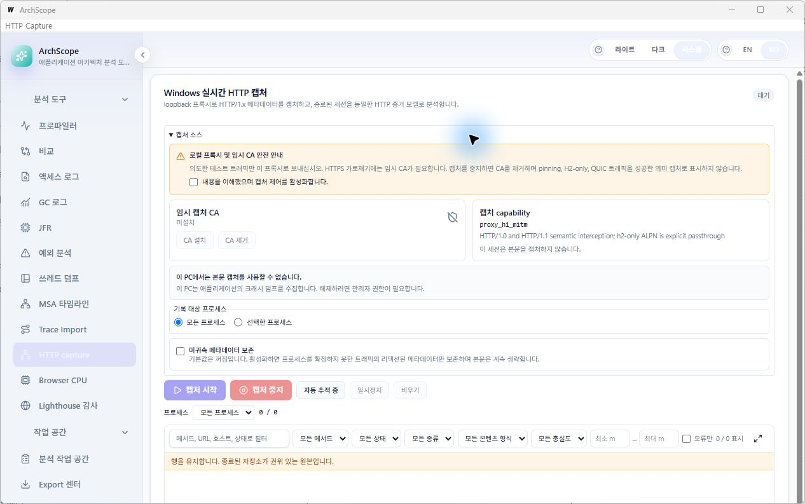

# Local Windows validation — 2026-11-09

Product baseline: `a9896c392d7117ca1dcfb28753d176fc9f917f78` plus the
Windows test/build fixes in `f09a3d89` and the subsequent live-state fix
committed with this report. This is local regression
evidence, not a new release acceptance or complete Stand-alone parity verdict.

## Repository synchronization

- Active repository: ArchScope; branch `main`, upstream `origin/main` at
  `https://github.com/aurakimjh/archscope.git`.
- Initial HEAD/upstream cache: `d348bcb`. Fetch found 12 newer commits.
- `git pull --ff-only origin main` fast-forwarded to `a9896c3`.
- No tracked local edits, unmerged paths, or merge/rebase/cherry-pick state
  were present. The pre-existing untracked `.tmp/` tree was preserved and is
  excluded from the commit.

## Local execution results

Host: Windows amd64, version 26H2, build 26300.9711; Go 1.26.3;
Node 22.15.1. Commands below ran in `apps/engine-native` unless noted.

| Check | Result |
|---|---|
| `go test ./... -count=1` | PASS: 77 test packages; 5 additional packages have no tests |
| `go vet ./...` | PASS |
| `go build ./cmd/archscope-engine ./cmd/archscope-app` | PASS |
| `TestWindowsLiveCaptureE2E` | PASS: actual loopback HTTP proxy, confirmed native process attribution, persisted/finalized exchange |
| `TestWindowsCaptureProcessSelectionE2E` | PASS: two real child processes from the native process snapshot; selecting one stores only its row, selecting both stores both rows; exact PID/start-time attribution and observed/persisted/dropped totals verified |
| Existing capture service controls and active-detail tests | PASS in the full suite and targeted native rerun |
| `npm run test:state` (frontend directory) | PASS |
| `npm run build` (frontend directory) | PASS |
| `task windows:build ARCH=amd64` (app directory) | PASS using the project's Wails CLI `v3.0.0-alpha2.117`; generated bindings match the baseline |
| `scripts/windows-gui-smoke.ps1 -ExePath apps/engine-native/cmd/archscope-app/bin/archscope.exe -StartupSeconds 15` (repository root) | PASS: 19,059,200-byte executable stayed alive for 15 seconds; the script requested graceful shutdown, then used its forced-shutdown fallback |
| Native WebView2 inspection | PASS for the metadata workflow after user acknowledgment: two real clients, process filtering, live Headers and omitted-Body inspection during new arrivals, F9/F2, and stop/reopen detail; captured payload remains unverified |
| Native resolver-cost measurement | PASS: 50/50 confirmed samples, mean 3.314 ms, p95 6.116 ms, maximum 7.411 ms; measurement only, no predeclared latency SLO |
| Local `go test ./... -race -count=1` | NOT RUN: Go reports that race requires CGO; this host has `CGO_ENABLED=0` and no discovered GCC/Clang toolchain |

The resolver measurement used `ARCHSCOPE_RUN_RESOLVER_PERF=1` and
`ARCHSCOPE_RESOLVER_PERF_OUT`, running
`go test -count=1 -v ./internal/capture/procmap -run '^TestWindowsResolverCostMeasurement$'`.
Its path-free output is [resolver-cost.json](resolver-cost.json).

The first sandboxed Go run failed because the sandbox denied replacement of
existing manifest files and loopback connections. The same targeted tests and
then the entire suite passed outside that sandbox on this Windows host. These
failures do not establish an application defect; no storage or socket security
checks were weakened to make them pass.

## Fixes and build hygiene

- Windows `.syso` cleanup now uses `powershell -NoProfile` and removes only
  the generated architecture-specific file. The original command loaded the
  user's PowerShell profile and emitted an `AuthorizationManager` error.
  The rebuilt task completed successfully with the corrected command.
- GUI startup smoke launches its temporary test process with a hidden window.
  Native interactive inspection separately used a visible repository build.
- Added a Windows-only two-client selection integration regression. It uses
  real process enumeration and TCP-owner attribution without resolver mocks,
  system proxy changes, or certificate installation.
- The preinstalled Wails CLI was `v3.0.0-alpha.87`. The pinned CLI was installed
  into the task's `.tmp/` tools directory and used for the successful rebuild.
  Incidental generated-binding and npm lockfile changes were restored; neither
  dependency versions nor generated API contents were changed.

## T-603 disposition: incomplete

T-603 remains `TODO`. The native app's source panel correctly reports that
the existing Windows crash-dump policy prevents body capture. No CA was
installed, no system proxy was changed, and the machine dump policy was not
relaxed. The user directly operated the safety acknowledgment and authorized
continuing the work; the earlier acknowledgment blocker is resolved.

The follow-up native run verified the following in the production Wails /
WebView2 executable, using two real `node.exe` clients identified by PID and
start time. Its loopback origin returned `X-ArchScope-Fixture: T603-local`,
`X-ArchScope-Client: A` or `B`, and a predictable text payload.

- F9 started recording and F2 stopped it.
- Both `/t603/client-a/fixed-first` and `/t603/client-b/fixed-first` appeared
  as `200 OK`, with distinct process-instance groups and 33 response bytes.
- Choosing client A in the process selector displayed only its requests.
  Sending another A and B request changed the scoped count to 2/4 while the
  original A request and its Headers tab remained selected. Request and
  response client markers were `A`; the response fixture marker matched.
- The Body tab explicitly reported that request/response bodies were not
  recorded. Another A request changed the count to 3/5 while preserving that
  tab and the selected request. Selecting the adjacent A request also kept
  the Body tab active and changed the reported response size to 35 bytes.
- Stop and Load finalized analysis reopened all five persisted requests:
  client A had three and B had two. Reopening the original A request retained
  its URL, `200` status, 33-byte response and matching request/response headers.
- The temporary origin/control servers and both fixture clients exited after
  the session stopped. The app was left on the finalized analysis.

An actual **captured payload** remains unverified because the existing body
gate is unavailable. The omitted-body UI check above is not payload-capture
acceptance, so T-603 is not marked complete and task counts remain unchanged.

### Defect found and fixed during native verification

The first native run on `f09a3d89` persisted both requests but left client A's
grid row at `request_sent`, `—`, and 0 bytes. Opening its store-backed detail
already showed `200 OK` and the correct headers. The pipeline publishes
persisted transactions and progress through separate batches, and an older
progress payload can arrive after a terminal payload. The renderer previously
replaced the row with whichever event arrived last.

The live-state merge now preserves the furthest known phase within the same
generation. Late request/receiving progress cannot overwrite complete, failed
or aborted rows, and request progress cannot reset a receiving row. Stable row
position, terminal status/timings, generation resets and existing row caps are
preserved. A regression reproducing the native failure failed before the fix;
the expanded state suite and production build passed afterward. The pinned
Windows production build also passed, and the same native two-client scenario
then retained both `200 OK` rows throughout the five-request recording.

| Native evidence | Screenshot |
|---|---|
| Stale progress on the original build | [Before fix](native-stale-progress-before.jpg) |
| Both clients terminal on the fixed build | [After fix](native-fixed-two-clients.jpg) |
| Process A scoped, Headers retained as more requests arrive | [Live headers](native-live-headers.jpg) |
| Body tab retained, truthful omitted-body state | [Live body state](native-live-body-omitted.jpg) |
| Same request headers after stop and reopen | [Reopened headers](native-reopened-headers.jpg) |

### CI for the first Windows-validation commit

At `f09a3d89`, [general CI](https://github.com/aurakimjh/archscope/actions/runs/42614995061)
and [Windows GUI Smoke](https://github.com/aurakimjh/archscope/actions/runs/42614995164)
passed. The [native Windows job](https://github.com/aurakimjh/archscope/actions/runs/42614994841/job/129152538526)
passed vet/build, the full race suite, live E2E, resolver measurement and SEC-10
forced-crash evidence with policy restoration. Linux and frontend jobs passed
as well. The overall Engine Native workflow concluded `cancelled` because
both macOS jobs failed to start with GitHub's diagnostic
`The configuration 'macos-14-arm64-us-default' is not supported`.

The app requests a 1280×800 window. Computer Use returned a 1266×793 bounded
native-window screenshot; it has not been resized or described as an exact
1280×800 acceptance image:

T-601/T-602 and the dependent T-613 parity work remain open according to the
existing registry. This run does not implement their missing capture modes,
exchange contracts, or remaining desktop features.
